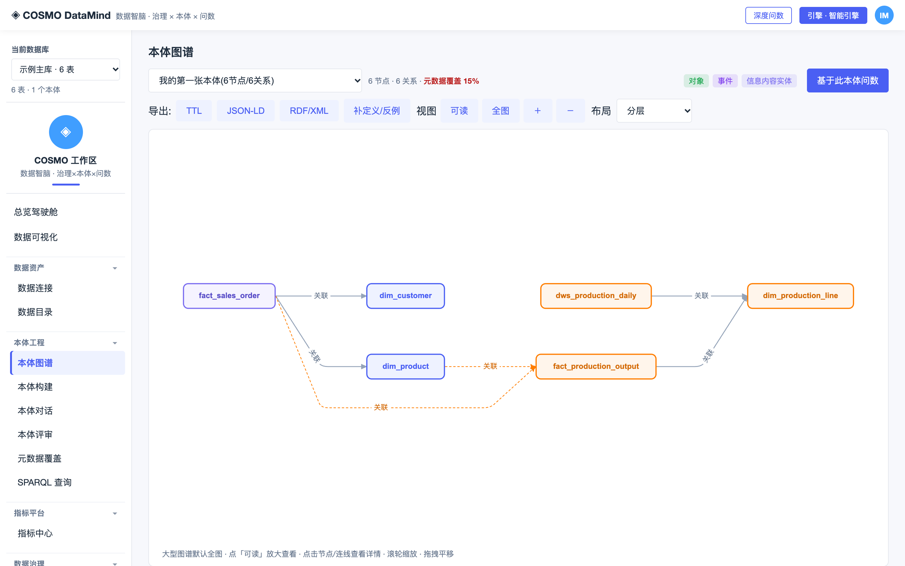
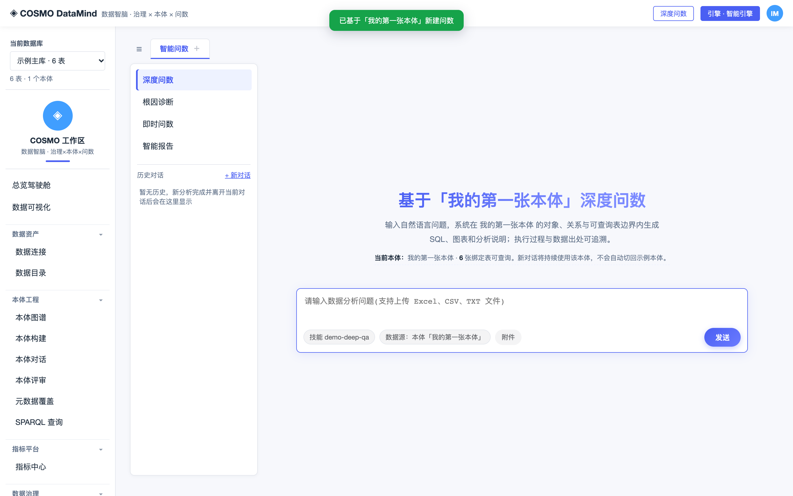
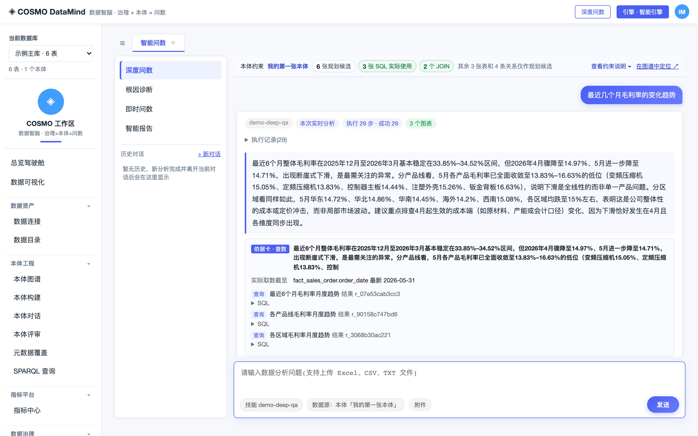
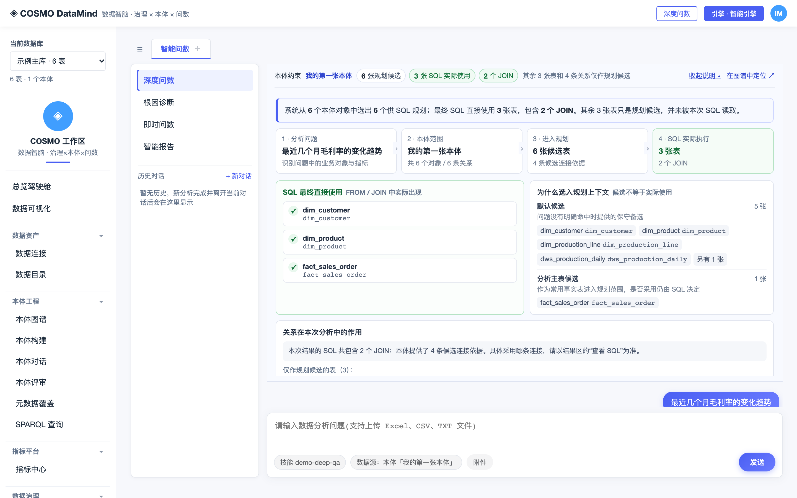
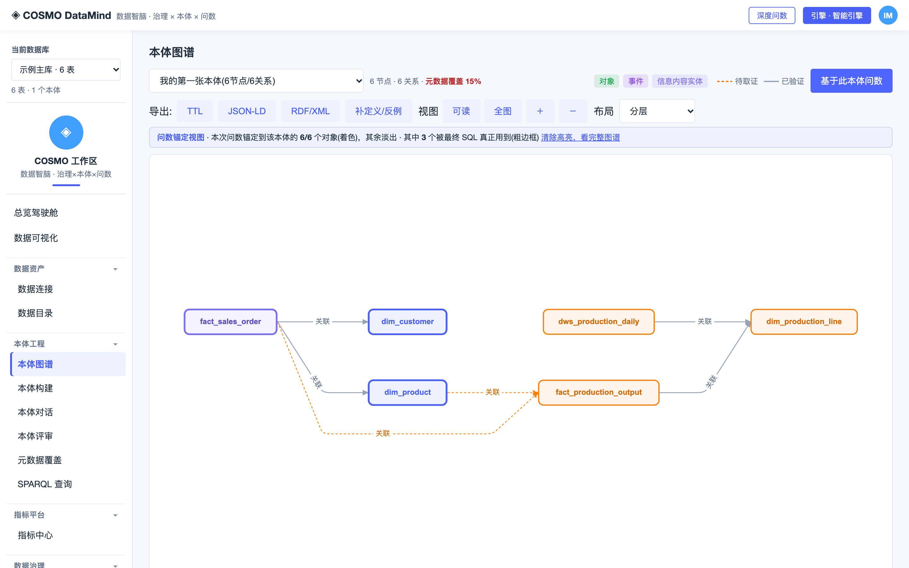

# 快速入门

本例从六张 SQLite 表生成本体，再用中文查询月度毛利率。建库、建本体和 SQL 复算可在本机离线完成。自然语言问数需要 OpenAI 兼容的模型端点，可使用仓库自带的驱动。

示例库是合成数据,其中的业务现象是预先构造的,可以稳定复现。文中的命令输出和截图取自 2026 年 11 月的版本;
模型生成的分析文字每次会有出入,数值以示例库为准。

---

## 0. 基本概念

**上游本体引擎。** 一个可选的外部组件(由 `DATAMIND_ENGINE_DIR` 指向),提供多智能体运行时和会话式构建。
它不随本仓库发布。本文走的是不接引擎的路径,全部步骤都能完成。

**大模型。** 本仓库自带 OpenAI 兼容驱动,配好以下环境变量即可,与上游引擎无关:

```bash
export DATAMIND_LLM_BASE=...    # 端点前缀,到 /v4 或 /v1 为止,不含 /chat/completions
export DATAMIND_LLM_KEY=...     # API Key
export DATAMIND_LLM_MODEL=...   # 模型名
export CLAW_DRIVER=openai       # 指定优先使用这个驱动
```

不设 `CLAW_DRIVER=openai` 时,系统按默认顺序查找其他驱动,表现为配了 Key 却没有调用模型。

**构建流程。** 接入模型时，模型可以提议候选关系。系统根据声明外键或连接键的取值、父键唯一性和命名等证据验证关系，分别记录已验证（`verified`）和待复核（`candidate`）状态。人工确认的关系单独标记为 `asserted`。本例使用本地程序 `quick_build.py`，直接从数据库取证。

---

## 1. 安装

```bash
git clone https://github.com/cosmoplat-opensource/cosmo-datamind.git
cd cosmo-datamind
python3 -m venv .venv && source .venv/bin/activate
pip install -r requirements.txt
```

## 2. 生成示例数据库

```bash
sqlite3 demo.db < examples/sample_db.sql
```

得到 6 张表(3 张维表、2 张事实表、1 张汇总表),共 2265 行,时间范围 2025-12 至 2026-05。

示例数据预置了数仓里常见的几种情况:

| 预置的情况 | 用途 |
|---|---|
| 表之间没有声明外键 | 关系只能从取值重叠推断 |
| 同一实体的列名不一致(`line_id` 与 `prod_line_id`) | 检验关系判定 |
| `prod_id` 与 `output_id` 都是从 1 开始的自增键 | 两列取值 100% 重合但并无关联,检验能否识别这种巧合 |
| 2026-04 起成本上升 | 留一个可以问出来的业务现象 |

## 3. 配置模型并启动

以智谱 GLM 为例(换成 DeepSeek、Qwen、OpenAI 或自建的 vLLM 服务,只改前三个变量):

```bash
export DATAMIND_DB="$PWD/demo.db"
export DATAMIND_LLM_BASE=https://open.bigmodel.cn/api/coding/paas/v4
export DATAMIND_LLM_KEY='替换为模型服务的 API Key'
export DATAMIND_LLM_MODEL=glm-4.5
export CLAW_DRIVER=openai
python3 server.py
```

打开 http://127.0.0.1:8092 ,并确认模型已接通:

```bash
curl -s http://127.0.0.1:8092/api/ont/runtimes
# 期望 "current_ready": true;为 false 时,同一份响应的 hint 字段写明缺什么
```

> **推理型模型需要放宽超时。** 这类模型单是思考就可能超过 60 秒。默认单轮超时 180 秒,
> 模型更慢时设 `export DATAMIND_LLM_TIMEOUT=300`。超时过短的表现是:执行记录的 `llm_plan`
> 一栏只返回几十个字符,随后改用内置模板。
> `DATAMIND_LLM_MAX_TOKENS`(默认 16384)同理:思考内容计入这个额度,设得过小正文会是空的。

## 4. 为自己的数据建本体

内置示例本体描述的是内置示例库,不适用于别的库。当前的库还没有本体时,问数页会提示先构建。先为它建一个:

```bash
python3 quick_build.py demo.db workdir/built_myfirst.json 我的第一张本体
```

输出:

```
[quick_build] 6 张表
[quick_build] 基础关系 6 条 (verified 4)
[quick_build] 最终对象 6 个 · 关系 6 条 · 动作 0 个
[quick_build] 完成 → workdir/built_myfirst.json
```

6 条关系里有 4 条已验证,另外 2 条是候选:`dim_product → fact_production_output` 和
`fact_sales_order → fact_production_output`。这两条都是 `prod_id` 对 `output_id`:两列都是 1、2、3……
取值重叠 100%,但键名词根不一致,所以没有标为已验证,留给人工审核。只看重叠率的话,它们会被当成真实的关联。

刷新页面,在「本体图谱」页的下拉框里选「我的第一张本体」:



灰色实线是已验证关系,橙色虚线是候选关系(右上角图例里标为「待取证」)。上方的「元数据覆盖 15%」统计的是定义、反例和标准关系映射的填写比例:
`quick_build` 只从数据推断结构,不生成定义和反例,这些需要之后由人工或模型补充。

## 5. 提问

在本体图谱页点右上角的「基于此本体问数」,进入深度问数页。输入框下方显示「数据源:本体「我的第一张本体」」:



输入:

> 最近几个月毛利率的变化趋势

各月毛利率(由示例库直接算出,可用 SQL 工作台核对):

| 月份 | 毛利率 % |
|---|---|
| 2025-12 | 34.40 |
| 2026-01 | 33.85 |
| 2026-02 | 34.52 |
| 2026-03 | 34.10 |
| **2026-04** | **14.97** |
| **2026-05** | **14.71** |



可在这个六表库的 SQL 工作台复算各月毛利率。先汇总订单金额和成本，再计算比率。

```sql
SELECT substr(order_date, 1, 7) AS month,
       round(100.0 * (sum(amount) - sum(cost)) / nullif(sum(amount), 0), 2) AS gross_margin_pct
FROM fact_sales_order
GROUP BY substr(order_date, 1, 7)
ORDER BY month;
```

4 月起毛利率大幅下降,就是第 2 步预置的成本上升。答案由三部分组成:

- **分析文字。** 由模型根据查询结果写出,每次措辞不同。这次模型除了整体趋势,还按产品线和区域各做了一次分析。
- **依据卡。** 列出每条查询及其结果编号,可展开查看 SQL。「实际取数截至」是查询所读表的时间列最大值。
  文字里的数字如果在查询结果中找不到出处,依据卡上会有提示。
- **图表与数据预览。** 在依据卡下方,每条查询一组。

对话区顶部的一行是本次分析用到的本体范围:

```
本体约束  我的第一张本体  6 张规划候选  3 张 SQL 实际使用  2 个 JOIN  其余 3 张表和 4 条关系仅作规划候选
```

`quick_build` 生成的对象只有英文表名,没有中文名和别名,中文问句匹配不到具体对象,系统就把全部 6 张表作为候选交给模型。
在「本体对话」页给对象补上中文业务别名后再问,候选范围会缩小到问句直接命中的对象。别名的写法见
[LLM 建本体与问数教程](docs/TUTORIAL-llm-build-qa.md)第四节。

执行记录里有时会出现这样一行(取决于模型这次写出的 SQL):

```
✗ ontology_gate  [3] 本体约束拦截:JOIN 键 dim_product.prod_line_id=dim_production_line.line_id 不在本体已验证关系上(关联未经数据验证,已拦截)
```

模型想把产品表和产线表直接关联,被本体约束校验拒绝。示例库里产品表的 `prod_line_id` 与产线表的 `line_id`
列名不同,`quick_build` 没有为它们建立关系;校验只接受已验证(`verified`)和人工断言(`asserted`)关系上的连接键,
候选关系同样不接受。两端列名相同的等值连接不在此列,会直接通过。被拒绝的查询由模型按原因改写一次,
改写后仍不通过的不执行,并在依据卡上列出。

## 6. 查看本体在这次分析中的作用

点顶部那一行右侧的「查看约束说明」:



- **SQL 最终直接使用**:FROM 和 JOIN 中实际出现的表。
- **为什么选入规划上下文**:每张候选表进入规划的原因,分为问题直接命中、关系扩展候选、默认候选和分析主表候选。
  刚建好的本体没有中文名,通常只有后两类。
- **关系在本次分析中的作用**:本体提供了几条候选连接依据,SQL 用了几个 JOIN;可展开查看每条连接依据和关系图。

点「在图谱中定位」跳到本体图谱页,本次进入规划的对象着色,SQL 实际用到的对象加粗边框:



本例的本体只有 6 个对象而且全部进入了规划,所以没有淡出的对象;在对象较多的本体上,未进入规划的对象会淡出。

---

## 常见问题

| 现象 | 原因 | 处理 |
|---|---|---|
| `current_ready` 为 false | 没有配 `DATAMIND_LLM_BASE` 或 `DATAMIND_LLM_KEY` | 看响应里的 `hint`;端点写到 `/v4` 或 `/v1` 为止 |
| 配了 Key,答案却来自内置模板 | 没有设 `CLAW_DRIVER=openai` | 补上后重启 |
| `llm_plan` 只返回几十个字符 | 推理型模型超时,回复被截断 | 调大 `DATAMIND_LLM_TIMEOUT` |
| 提示「当前数据库尚无可查询的本体」 | 还没有为当前的库建本体 | 完成第 4 步,再从本体图谱页进入问数 |
| 没配模型,问数没有图表 | 内置模板只针对内置示例库 | 配置模型,或改用内置示例库 |
| 大量关系是候选状态 | 证据不足以标为已验证 | 到「本体评审」页逐条审核,通过后成为人工断言(`asserted`) |

## 不配模型能做什么

| 能力 | 不配模型 | 配了模型 |
|---|---|---|
| 浏览本体、指标、数据质量、术语、动作中心 | 可用 | 可用 |
| SQL 工作台(只读)、SPARQL、标准格式导出 | 可用 | 可用 |
| 建本体 | 可用,只走数据验证 | 可用,模型提出候选后再做数据验证 |
| 本体检查(验收问题、漂移、结构一致性、兼容性、模块划分) | 可用,全部是确定性计算 | 同左 |
| 深度问数 | 仅内置示例库(内置模板是为它写的) | 任意库 |

## 接入上游引擎(可选)

如果另有兼容的引擎目录(提供 `engine/agent_runtime.py` 与 `web/skills_seed/`):

```bash
export DATAMIND_ENGINE_DIR=/path/to/ontology-engine
```

接入后可以使用会话式本体构建,以及 `hermes`、`claude-code`、`openclaw` 等运行时。

使用 OpenClaw 时,系统调用的是本机已安装的 `openclaw` 命令行(会话保存在 `~/.openclaw/`)。OpenClaw 连接哪个网关
在 OpenClaw 客户端里配置,本系统不直接连接网关。配置顺序:先在 OpenClaw 里连通网关,再设
`DATAMIND_ENGINE_DIR` 与 `CLAW_DRIVER=openclaw`。

---

[返回项目首页](README.md) · [功能与接入文档](docs/README.md) · [设计决策与验收记录](specs/map.md)
