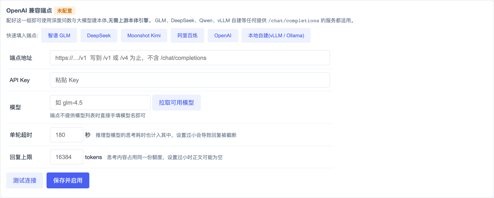
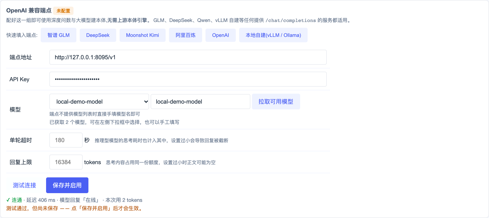

# COSMO DataMind

集数据治理、工业本体和深度问数于一体的原型系统:从业务数据库构建带类型、带计算规则、带证据的工业本体,供人和智能体在其约束下问数、诊断和发起动作。

Apache-2.0 · Python + Flask + 原生 JS(无前端构建步骤)· 单端口本地运行

---

## 它解决什么问题

大模型接入企业数据时,主要障碍通常是业务语义与物理数据模型不一致:

- 同一个业务键(如工单号)在不同表里列名不同,表间关系没有在库里声明;
- 含义相近的指标(如直通率和良率)被混用,答案给出了数值,却说不清计算规则;
- 跨表 JOIN 的连接键由模型猜测,出错时没有校验。

COSMO DataMind 先用模型批量提出候选项，再用数据库约束和完整取值集合的 SQL 聚合验证连接关系，由人工确认业务语义。构建时可选择或不选择制造/化工/PCBA 行业参照与 BFO+IOF、ISA-95、UFO 本体标准；系统记录每条关系的验证依据和状态，无法确认的标准映射保留为本地属性。

## 核心特性

| 能力 | 说明 |
|---|---|
| **半自动本体构建** | 行业/本体标准（可不选，参照或强约束）+ CQ/技能方法 → 候选提议 → 语义复核 → 数据验证 → 确定性验收 → 人工确认。`verified` 至少要求通过引用完整性检查的声明外键，或完整取值重叠(≥60%)、父键唯一、命名依据与方向检查同时成立；依据不足时保留为 `candidate` |
| **证据分层** | 每条关系带状态 `verified` / `asserted` / `candidate` / `gap`;图谱中以线型区分 |
| **深度问数** | 自然语言 → 本体定位对象与计算规则 → 生成 SQL → **只读执行** → 带出处作答;同屏给出指标计算规则卡(计算规则/数据出处/血缘) |
| **本体约束说明** | 对话区顶部显示本次分析所用的本体、进入规划的候选表、SQL 实际使用的表和 JOIN 数;可展开查看每张候选表的入选原因和连接依据,并跳到图谱页定位用到的对象 |
| **指标计算规则** | 指标声明「怎么算」(聚合/过滤/时间/维度),依据声明确定性编译 SQL、只读执行并与参照(历史 SQL / 指标定义表 / 已保存的 SQL / 参考基准)比对;`verified` 只来自可执行且与参照一致,`certified` 只能由人确认。指标中心显示状态、计算规则、编译 SQL、核验证据与可下钻维度,人工只能「业务确认 / 停用 / 撤回」;计算规则卡按状态分级,对外只放行 certified |
| **本体约束校验** | SQL 执行前校验:表须在本体白名单内,JOIN 键须落在已验证关系上,一对多关联后对父表列求和、求平均或计数,以及两张子表互相放大的聚合,按重复计数(扇出)风险拒绝执行 |
| **根因诊断** | 沿本体关系两跳召回,输出限定在本体范围内的候选根因与检查清单;问句没有匹配到本体对象时不作答 |
| **动作层** | 类型化参数 + 风险分级:低风险直接形成动作记录,高风险须人工审批,操作均有记录。当前为 `decision_capture`，不写回业务系统；经 MCP 对外时,**发起动作是唯一写工具,审批不开放** |
| **构建 Agent 接口** | 半自动构建经 MCP 对外(`mcp_build_server.py`):外部 Agent 可发起构建、跟踪作业、读取验收结果与人工审核队列;**发起构建是唯一写工具**,`verified`、`asserted`、`certified` 只能由数据验证和人工确认产生,不提供改写状态的工具 |
| **标准导出** | OWL2 / RDF / SHACL / SKOS / JSON-LD,并提供 SPARQL 端点;另可导出 **Apache Ossie**(原 OSI)语义模型与本体 YAML(按官方 schema 0.2.0.dev0 快照生成,示例本体已通过其官方 validator)与关系型语义层投影 |
| **问数评测** | 参考问题集 × 三组同题对照(无检索增强 / 图谱增强 / 本体增强)。各组用同一套比对规则,另给结果集严格一致与列容忍两种口径;可重复运行,组间差给出按题配对的 95% 区间;统计参考答案所需的表和列是否进入了给模型的上下文(候选上限) |
| **SQL 本体检查接口** | `POST /api/ont/check` 与 MCP 只读工具 `check_sql`:外部智能体在执行前提交 SQL,得到与问数相同的校验结论、原因和每个连接条件对应的关系状态,只检查不执行 |
| **算术见证** | 构建时找出表内逐行成立的「一列 = 两列的和、差、积、商」(如毛利 = 金额 − 成本),据此核验模型提出的派生公式,问数时告诉模型 |
| **名称不透明库的数据接地** | 表名、列名是代码又没有字典时,依据取值画像和业务问题里的口径说明,把用语对应到列(经数据核验),并为表和列起候选名(理由须能在数据里找到) |
| **反馈回放** | 反馈时保存答案的数据摘要;本体修改后按当前本体重新提问,比对答案的数据有没有变;可连问多次,结论不一致时记为结果不稳定;还可在反馈时的本体和当前本体上交替提问做配对比较,把本体修改的影响与模型随机性分开;「有用」的反馈可批量回放检查退化,配对时给出差值的 95% 区间 |
| **本体检查** | 验收问题(CQ)核验、数据源漂移、图结构检查(孤岛/自反/重复边/超级节点)、向后兼容影响面、模块化建议、导出形状校验(SHACL) —— 全部确定性计算,不调 LLM |

## 数据库切换

侧栏的“当前数据库”选择器统一切换总览、数据目录、质量、术语、图谱、指标、问数和本体工作台。
连接管理中登记且文件可用的 SQLite 库会显示在选择器中；切换保留当前页面及各库的输入草稿。
仓库附带 108 表示例库；200 表合同制造验证库可用 `scripts/build_contract_200_db.py` 生成。界面上的表数取自实际数据库。

上传带多级表头(合并单元格)的 CSV 时,表头展开为一行列名;上层是期间时另存一张按期间展开的长表。
SQL 工作台与可视化还可单独选择来源。保存的看板逐图保留来源，图卡显示对应数据库；切换全局来源不会改写已有图表的来源。
无本体的数据库可以直接预览、运行只读 SQL 和制作图表，问数与本体编辑需先构建该库的本体。
来源失效或所选本体属于另一库时，接口明确报错，不返回默认库答案。

非默认库的内置评测提供本库的简单行数功能检查，不代表业务问数准确率。
模型配置、连接配置、任务管理和通用技能仍在整个工作区共享。

## 从这里开始

第一次使用请看 **[QUICKSTART.md](QUICKSTART.md)**:生成示例库、建本体、提问,约 15 分钟,
只需要一个 OpenAI 兼容的 API Key,不需要上游引擎。

## 安装与部署

以下为安装命令；本轮验证环境及范围见审计报告。

### 1. 安装

```bash
git clone <repo-url>
cd cosmo-datamind
python3 -m venv .venv && source .venv/bin/activate
python -m pip install --upgrade pip==26.2
pip install -r requirements.txt
```

### 2. 配置(可选)

```bash
cp .env.example .env               # 按需填写;全部留空也能启动
export DATAMIND_DB=/path/to/your.db          # 只读 SQLite 数据源
export DATAMIND_WORKDIR=/path/to/datamind-workdir     # 运行态本体/上传/审计目录（可选）
export DATAMIND_ENGINE_DIR=/path/to/ontology-engine   # 上游引擎(可选)
```

这些变量都不设也能启动:图谱页可以浏览内置示例本体(108 个对象、60 条关系),
需要数据库的接口会在响应里标明「数据库不可用」。

### 3. 启动

```bash
python3 server.py                  # 仅本地开发，前台运行 → http://127.0.0.1:8092
# 或
./start.sh                         # 读取 .env，以 Gunicorn 常驻运行；日志在 .deploy/
```

状态：`./status.sh`；停止：`./stop.sh`；更新后重启：`.venv/bin/python scripts/service.py restart`。
管理器只控制自己 PID 文件对应的 Gunicorn，不会按端口终止其他程序。

### 4. 验证与测试

```bash
curl http://127.0.0.1:8092/api/overview      # KPI 概览(无库时含 warning 字段)
python3 test_all.py                          # 系统级回归(源码定义 548 个检查点;需服务已启动)
```

开发与 CI 推荐使用隔离入口，自动复制已提交的验证种子到临时目录并禁用本机模型配置：

```bash
python -m pip install --upgrade pip==26.2
pip install -r requirements-dev.txt -r requirements-ui.txt
python -m playwright install chromium
python scripts/check.py --suite all
```

可分别选择 `--suite unit`、`integration`、`ui`；日志、逐层退出码和浏览器截图在 `.check-results/`。
`pytest` 默认也使用临时运行目录；Node.js 用于执行真实前端函数的行为测试。
逐次执行记录保留在本地或 CI 附件中，结果须关联被检查的代码版本。
需求到测试映射见 [specs/acceptance.json](specs/acceptance.json)。

### 5. 用内置示例走一遍主要功能

内置示例本体(108 对象 / 60 关系)可直接浏览。问数、数据分析与关系检验需要把
`DATAMIND_DB` 指向可读的 SQLite 数据库；可用 `examples/sample_db.sql` 创建最小示例库。

**① 看本体** → 左侧「本体图谱」。点节点看绑表与属性,点连线看关系证据
(子键→父键、取值重叠率、证据来源)。

线型表示关系状态(全站统一,本体图谱与问数锚定子图共用同一套):
**灰实线**=`verified`(已通过数据验证)、**靛蓝虚线**=`asserted`(人工断言)、
**紫点线**=`inferred`(推理得出)与两跳可达路径、**橙虚线**=`candidate`(待取证)与 `gap`(证据不足)。
**内置示例本体 60 条关系当前均标记为 `verified`（表示连接关系经过数据验证，不代表业务语义已获专家确认）**。要查看多种状态并存的图谱,
在下拉框里换到构建产物(`built_*`,含 `candidate`)或上游引擎产物(含 `gap`)。

**② 提问** → 「深度问数」,点示例问题或自己输入。每次提问都重新执行查询,不读取缓存;
以前的答案在左侧「历史对话」里。对话区顶部的一行显示本次分析用到的本体范围
(所用本体、进入规划的候选表数、SQL 实际使用的表数和 JOIN 数)。点「查看约束说明」可以看到每张候选表的入选原因
和连接依据;点「在图谱中定位」跳到图谱页,本次用到的对象着色,其余淡出。

**③ 换一个本体再问** → 在本体图谱页选中另一个本体(如构建产物)后点「基于此本体问数」,
或在问数框下方的「数据源」里改选,再问同一个问题。候选表、连接依据和本体约束校验都改用所选的本体。
只有绑定表在当前数据库里的本体可以用于问数;其余本体在选择框里不可选,但仍可浏览和治理。

**④ 建一个本体** → 「本体构建」页选数据源后直接构建(只走数据验证,不需要模型),
或接入引擎后用会话式构建。产物出现在图谱列表里,可以直接用于问数(见 ③)。

构建页的“行业与本体标准”可分别选择：不选择、参照或强约束。参照模式下未满足的核心项进入
人工复核，强约束模式下未满足的核心项使验收结果为“不通过”；两种模式下缺少证据的参照项都不会生成对象。
继续构建默认沿用基础本体最近一轮的选择，也可以在本轮改选。ISA-95/UFO
标注是候选对齐，不代表标准认证或完整合规。BFO 2020、IOF Core、gUFO 与 MESA
B2MML（ISA-95 的公开 XML 实现）已固定版本放在 `ontology/standards/`，构建只读本地
资产并记录内容指纹；不包含 ISA/IEC 付费标准正文。目录接口失败时，页面仍提供完整的
离线选项，并显示失败原因和重试入口。

要评估本体对问数准确率的影响,可在「问数评测」页运行三组同题对照(无检索增强、图谱增强、本体增强)。

### 6. 生产部署(可选)

`requirements.txt` 已包含 Gunicorn。生产环境从专用 WSGI 入口启动，且只监听回环地址：

```bash
gunicorn -c gunicorn.conf.py wsgi:application
```

本机实际部署推荐 `./start.sh`，它从 `.env` 读取配置、归一数据路径并启动独立后台 Gunicorn。
`./status.sh` 显示数据库健康和运行版本是否落后于当前源码；源码或配置更新后执行
`.venv/bin/python scripts/service.py restart`。端口可用 `./start.sh --port 18092` 显式覆盖。
重启先检查环境文件和数据库路径；这两类配置错误不会停止正在运行的服务。
进程退出终端后继续运行；此入口不安装系统开机自启。

配置固定为单 worker + 有界线程，因为会话、作业和锁仍是进程内状态；超时默认 1800 秒，
可容纳长构建/SSE，但仍有硬上限。Nginx 模板在
[`deploy/nginx/cosmo-datamind.conf`](deploy/nginx/cosmo-datamind.conf)，已保留 Host、关闭 SSE
缓冲并设置上传/请求超时。TLS 在代理终止时设置 `DATAMIND_PUBLIC_ORIGIN=https://你的域名`；额外主机用 `DATAMIND_TRUSTED_HOSTS` 明确声明。部署时必须补 TLS 与身份认证——本服务自身不含用户体系，见
[SECURITY.md](SECURITY.md)。

## 两种运行方式

系统可以独立运行,也可以接入上游引擎运行,差别只在需要大模型的环节:

| 功能 | 独立运行(默认) | 接上游引擎 |
|---|---|---|
| 图谱浏览 / 指标 / 数据质量 / 术语 / 动作中心 | ✅ | ✅ |
| SQL 工作台(只读) / SPARQL / 标准导出 | ✅ | ✅ |
| 深度问数 | ✅ 配置 OpenAI 兼容端点后由模型生成查询;未配置时改用内置模板(只针对内置示例库) | ✅ 模型生成查询计划 |
| 本体构建 | ✅ 纯数据驱动(`quick_build`) | ✅ LLM 基于数据库和可解析文档提议 + 确定性验证 |
| 对话式本体编辑(apply/undo) | 部分操作可用(确定性的编辑与评审操作);由模型理解修改要求的部分需要模型 | ✅ |
| 内置构建技能库 | ✅ 本仓通用技能 `ontology-semi-auto`、`ontology-build-method`、`ontology-cross-check`、`decision-driven-ontology`(从决策倒推,面向排产与交期等工序主线场景);领域技能 `energy-carbon-ontology`、`electronics-manufacturing-ontology` | ✅ 本仓 + 上游技能 |

上游本体引擎是可选组件,不随本仓库发布;本仓库的开源范围只包括 COSMO DataMind 自身。
若你拥有兼容的引擎目录(提供 `engine/agent_runtime.py` 多运行时抽象与 `web/skills_seed/` 构建技能),
一个环境变量即可接入:

```bash
export DATAMIND_ENGINE_DIR=/path/to/ontology-engine
```

未配置引擎时,相关接口返回"无可用运行时",对应功能改用不依赖模型的方式运行,并在界面上标明。

## 引擎设置

深度问数和借助模型建本体都需要接入一个大模型。任何 OpenAI 兼容端点都可以,不需要上游本体引擎:
GLM、DeepSeek、Qwen、Moonshot,以及用 vLLM、Ollama 自建的服务都适用。

有两种配置方式:在界面上配置(推荐,可以先测试再保存),或用环境变量配置(适合容器和 CI)。

### 在界面上配置（推荐）

打开「引擎设置」页,第一张卡片是 **OpenAI 兼容端点**。下面的截图用的是一个本机的测试端点,
配置其他服务的步骤相同:



**第一步,填端点地址。** 点上方的服务商按钮填入预设地址,或手工输入。

> 端点地址写到 `/v1` 或 `/v4` 为止,不要带 `/chat/completions`。
> 保存时会校验协议,`ftp://` 之类的地址会被拒绝。

**第二步,粘贴 API Key。** 输入框为密码类型;保存后只显示掩码（如 `******DEMO`）,
不能读回明文。已保存过 Key 时,该框留空表示不改动。

**第三步,选模型。** 点「拉取可用模型」会请求端点的 `/models` 接口,
成功后左侧出现下拉框,选中的模型名填入右侧输入框。部分服务不提供该接口,
这时界面提示获取失败,在输入框里手工填写模型名即可。

**第四步,测试连接。** 点「测试连接」,用当前填写的配置发一次最小请求:



返回延迟、模型的回复和本次消耗的 token 数;推理型模型还会返回思考内容的字数(截图中的测试端点不是推理型模型,所以没有这一项):

| 返回项 | 用途 |
|---|---|
| 延迟 | 用来估计单轮超时。问数时的提示词比测试请求长得多,实际耗时会明显更长 |
| 思考内容字数 | 不为零说明是推理型模型,回复上限要留足 |
| 正文为空而思考内容很长 | 额度被思考内容用完,界面会提示调大回复上限 |

测试失败时显示端点返回的报错（如 `HTTP 401 令牌已过期或验证不正确`）,
报错里如果含有 Key,会先掩码再显示。

**第五步,保存并启用。**


保存后状态变为「已就绪」,当前运行时同时切换到该端点,并在提示中说明,不需要再手工切换。

### 超时与回复上限

| 参数 | 默认 | 何时需要调整 |
|---|---|---|
| 单轮超时 | 180 秒 | 推理型模型的思考耗时也计入其中。设置过小时,执行记录里 `llm_plan` 只返回几十个字符,随后改用内置模板,原因是回复被截断 |
| 回复上限 | 16384 tokens | 思考内容占用同一份额度。设置过小时正文可能为空,表现同上 |

### 用环境变量配置

容器化部署,或不希望密钥写入磁盘时,用这种方式:

```bash
export DATAMIND_LLM_BASE=https://open.bigmodel.cn/api/coding/paas/v4
export DATAMIND_LLM_KEY=<your-key>
export DATAMIND_LLM_MODEL=glm-4.5
export CLAW_DRIVER=openai            # 必须,否则不会优先使用该端点
export DATAMIND_LLM_TIMEOUT=180      # 可选
export DATAMIND_LLM_MAX_TOKENS=16384 # 可选
python3 server.py
```

环境变量优先于界面配置:由环境变量设定的项在界面上置灰并注明原因。

检查是否生效:

```bash
curl -s http://127.0.0.1:8092/api/ont/runtimes
# 关注 "current_ready": true;为 false 时同一份响应里的 hint 会写明缺什么
```

端点和 Key 缺任何一项,该驱动都不会注册,系统报告「无可用运行时」并改用内置模板。

### 其他配置项

| 变量 | 作用 |
|---|---|
| `DATAMIND_DB` | 只读数据源路径 |
| `DATAMIND_WORKDIR` | 运行态本体、上传库、审计与自定义技能目录（默认 `./workdir`） |
| `DATAMIND_ENGINE_DIR` | 上游本体引擎目录（可选,见上文「两种运行方式」） |
| `DATAMIND_HOST` / `DATAMIND_PORT` | 默认 `127.0.0.1:8092` |
| `DATAMIND_MAX_REQUEST_BYTES` | HTTP 请求体上限，覆盖文件上传与聊天附件；默认 25 MiB |
| `OPENAI_API_KEY` 等 | 各家密钥,供接入上游本体引擎后的 CLI 型运行时继承 |

完整清单见 [`.env.example`](.env.example),部署细节见 [INSTALL.md](INSTALL.md)。

### 进阶教程

[接入大模型、会话式建本体、基于本体问数](docs/TUTORIAL-llm-build-qa.md):
GLM 的配置步骤(OpenAI 端点的配置方式相同,但未实测)、用自然语言建一个带中文名的本体并用它问数,
以及错误关系控制在构建和问数两个环节的运行记录。

## 安全

默认只监听本机,不含用户体系和鉴权。没有反向代理鉴权时,请勿暴露到公网。
内置的防护措施(只读执行的三重限制、CSRF 校验、路径穿越校验、标识符校验、SPARQL 禁止外部请求)
和已知限制见 [SECURITY.md](SECURITY.md)。

## 建模规则文档

`specs/` 下是规约驱动开发(SDD)的记录,保存开发过程中的设计决策及其依据:

- `specs/decisions/` — 决策记录(DR-xxx),每篇写明背景、选项、取舍和代价
- `specs/iterations/` — 迭代记录(IR-xxx),含验收标准和实测结果
- `specs/map.md` — 入口索引

审查报告、执行日志、探索方案、评审附件、来源迁移快照与 `specs/contracts/` 仅保留本地副本，
不随产品仓库提交。当前功能与调用方式以本文件和 `docs/` 中的产品指南为准。

半自动构建方法的核心取舍（为何数据验证优先于模型判断、为何人工确认产生 `asserted`、
如何执行确定性验收检查、如何选择或不选择行业/标准）记在 `DR-002`、`DR-011`、
`DR-050` 与 `DR-052`;执行顺序见
`docs/pipelines/ontology_build.yaml`。

## 测试

```bash
# 单元层:离线,不需起服务(确定性模块的隔离测试;整套耗时随环境变化)
python3 -m venv .venv
.venv/bin/python -m pip install --upgrade pip==26.2
.venv/bin/pip install -r requirements-dev.txt
.venv/bin/python -m pytest tests/ -q      # 单测 + 文档与规格映射自检
.venv/bin/coverage run -m pytest tests/ -q && .venv/bin/coverage report   # 全部模块低于74.0%时失败;分层下限见 scripts/check.py

# 集成层:需先起服务（用生产 WSGI 路径验证）
.venv/bin/gunicorn -c gunicorn.conf.py wsgi:application &
.venv/bin/python test_all.py            # 系统级回归(源码定义 548 个检查点)
.venv/bin/python test_ui.py             # 全 UI 走查:页面渲染 + 子 UI 交互(需 playwright)
.venv/bin/python test_ui_ops.py         # UI 逐步实操:切引擎/建本体/对话改本体/审计/问数/选本体锚定
```

两层分工:单元层测确定性模块的边界与纯函数(离线可跑),集成层测端到端接口约定与安全约束。
套件覆盖路由可达性、只读约束、CSRF、路径穿越、证据分层一致性、编辑回放等。
未配置上游引擎时，依赖它的用例会明确记为条件跳过；其余检查仍须零失败。

### 业务概念与数据目录(DR-093)

构建页可分别填写**业务问题样本**和**验收问题**。业务问题用于提议概念、分析主题、派生公式和取数建议；同文的验收问题从这一步排除。每轮最多处理 1000 条，超限与未完成数量在构建过程中显示。未填写业务问题时，不额外调用概念提议模型。

系统会自动读取库内字段文档，识别名称—取值型指标数据，记录代码覆盖和单位歧义。概念别名参与问数的表召回，提示仅使用相关内容，并遵守所选表范围。定义和公式均保持待确认：查询有数据不代表业务含义正确，派生公式须另经指标计算规则的执行核验。

在**本体评审 → 业务语义复核**中可查看绑定与 SQL 依据，确认含义或否决，记录评审人并支持撤销。继续构建会重新检查已有机器绑定，失效条目保留供复核并退出问数提示。

已有本体不会自动被新版本改写；选择原本体继续构建可补齐上述目录和概念层。实现选择、证据边界与限制见 [DR-093](specs/decisions/DR-093-research-semantic-capabilities.md)。

### 开发约定(DR-066)

主要的回归手段是场景回归基准(DR-067):用湖仓、元数据业务库和名称—取值型指标库的合成数据端到端运行构建前检查、构建、复核与问数,与标准答案比对;`python3 scripts/scenario_bench.py` 逐项打印检查结果。此外有三类自动检查:流水线说明与构建代码的步骤一致
(`tests/meta/test_models.py`)、领域模块不依赖 Web 层(`tests/meta/test_architecture.py`)、
表族识别与观测脱敏的性质测试(`tests/unit/test_properties.py`)。构建与问数的追踪和指标见
`/api/obs/metrics`、`/api/obs/runs`。

## 贡献

欢迎 issue 与 PR。改动请先写测试并登记需求,附上对应的 DR 说明,并保证
`scripts/check.py --suite unit` 全部通过、`test_all.py` 不出现新的失败项。
安全问题请勿公开提交,见 [SECURITY.md](SECURITY.md)。

## 许可证

[Apache-2.0](LICENSE)。第三方组件署名见 [NOTICE](NOTICE)。
