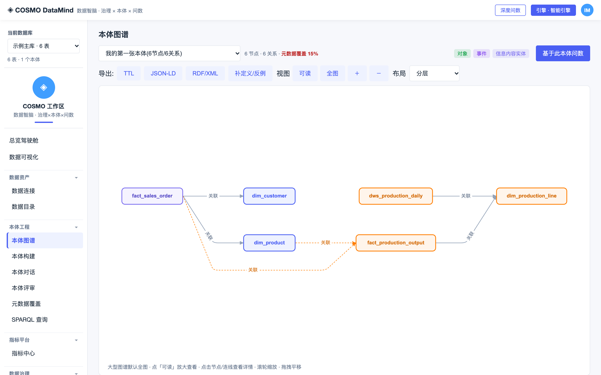
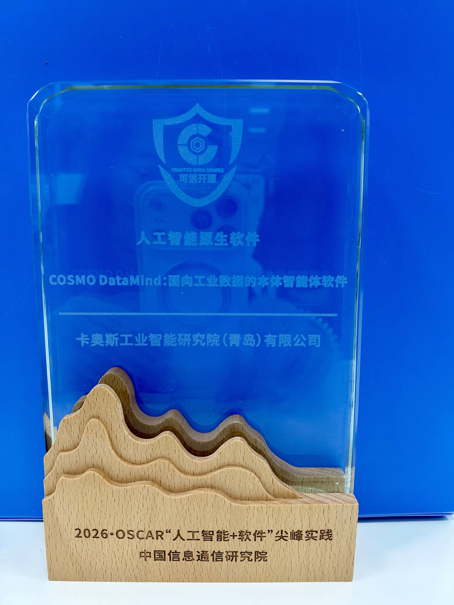

# COSMO DataMind

[](https://github.com/cosmoplat-opensource/cosmo-datamind/actions/workflows/ci.yml?query=branch%3Amaster)

COSMO DataMind 是面向工业数据的开源本体建模与分析工作台。它把数据库里的表、字段和连接键对应到订单、产品、产线等业务对象，记录对象之间的关系和指标的计算口径。业务人员可以用中文提问，再从答案查看实际执行的 SQL、用到的数据表和查询结果。

[快速入门](QUICKSTART.md) · [文档目录](docs/README.md) · [安装部署](INSTALL.md) · [项目获奖](docs/awards/README.md)

## 在本机运行

在 macOS 或 Linux 上安装 Python 3.10 或更高版本，在终端执行以下命令。第一次试用可直接打开随仓库提供的制造运营示例库，无需配置模型密钥。

```bash
git clone https://github.com/cosmoplat-opensource/cosmo-datamind.git
cd cosmo-datamind
python3 -m venv .venv
source .venv/bin/activate
python -m pip install -r requirements.txt
DATAMIND_DB="$PWD/examples/demo_metrics.db" python server.py
```

打开 [本地工作台](http://127.0.0.1:8092)，在“本体图谱”中选择对象查看绑定的数据表，点击连线查看连接键与验证依据。示例库含 108 张合成数据表，覆盖销售、采购、生产、质量和能耗等业务。本机后台运行可用 `./start.sh`，用 `./status.sh` 查看状态，`./stop.sh` 停止服务。向其他用户开放访问时，需在反向代理上配置身份认证和 TLS。[示例数据说明](examples/README-demo.md) · [部署指南](INSTALL.md) · [安全说明](SECURITY.md)

## 从六张表追溯一次毛利率变化

快速入门使用独立的六表制造业示例。订单表里有日期、金额和成本。按月汇总后，以“（订单金额合计 − 成本合计）÷ 订单金额合计”计算，2026 年 3 月毛利率为 **34.10%**，4 月为 **14.97%**，下降 **19.13 个百分点**。数据由脚本预置，可用只读 SQL 复算。[建表与数据脚本](examples/sample_db.sql) · [构建与问数步骤](QUICKSTART.md)



六张表可在本地生成六个对象和六条关系，其中四条通过数据验证，两条保留为候选。例如，产品编号与产出记录编号都是从 1 开始的整数，即便取值完全重合，也不足以认定它们指向同一对象。接入兼容的模型端点后，可在“深度问数”中提问“最近几个月毛利率的变化趋势”，查看答案所用的表和 SQL。[模型配置与问数教程](docs/TUTORIAL-llm-build-qa.md)

## 主要功能

- **数据目录与本体构建。** 浏览表和字段，从数据库结构与取值推断对象关系。可引入业务文档和行业标准辅助建模，由业务人员复核候选关系、名称和定义。
- **指标与问数。** 定义指标的聚合、过滤条件与时间范围，编译并核验 SQL。问数时按所选本体检查取数范围、连接条件和重复计数风险，在答案中查看计算依据。
- **评审与维护。** 检查数据源变化，查看关系证据，记录人工判断，管理本体版本。可在修改前后重跑同一组问答，比较结果。
- **标准与系统接入。** 导出 RDF、JSON-LD 等格式，通过 SPARQL 查询图谱。外部智能体可按授权发起构建、查询进度，或提交 SQL 获取执行前的检查结果。
- **领域应用。** 制造与能碳建模可选用领域技能。机器人示例从行为树 XML 和节点模型构建 OWL，根据任务生成候选行为树，供离线校验。

不接模型即可构建本体、浏览图谱和运行只读 SQL。对自有数据进行自然语言问数，可在“引擎设置”中配置 OpenAI 兼容端点。外部本体引擎为可选组件。[功能与接入文档](docs/README.md)

## 项目获奖

**2026 OSCAR“人工智能+软件”尖峰实践**入选项目为“COSMO DataMind：面向工业数据的本体智能体软件”，类别为“人工智能原生软件”，奖牌署名卡奥斯工业智能研究院（青岛）有限公司。

<a href="docs/img/awards/oscar_prize.jpeg"></a>

在 2026 年“数据要素×”大赛中，DataMind 为“面向高价值工业场景的智能体集群研发与应用”项目提供工业本体构建能力。该项目获全国总决赛工业制造赛道二等奖。[获奖名单与现场照片](docs/awards/README.md)

## 开发与许可

后端使用 Python 和 Flask，前端使用原生 JavaScript。提交代码前可用 `python scripts/check.py --suite unit` 运行单元、前端行为和静态检查。HTTP 回归与桌面、窄屏浏览器验收有独立入口。[开发与测试](docs/README.md#开发与测试) · [系统架构](ARCHITECTURE.md) · [贡献约定](AGENTS.md)

项目采用 Apache License 2.0。随仓分发的第三方组件及标准资源保留各自许可。[许可证](LICENSE) · [第三方署名](NOTICE) · [标准资源与许可](ontology/standards/README.md)
