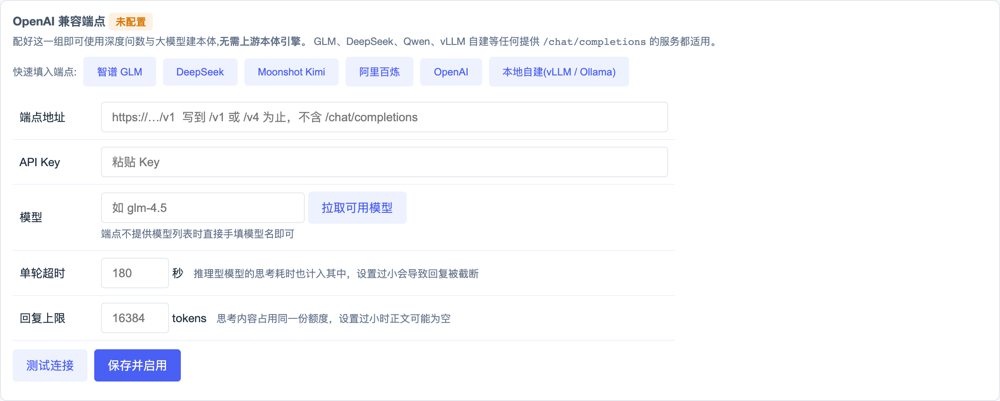
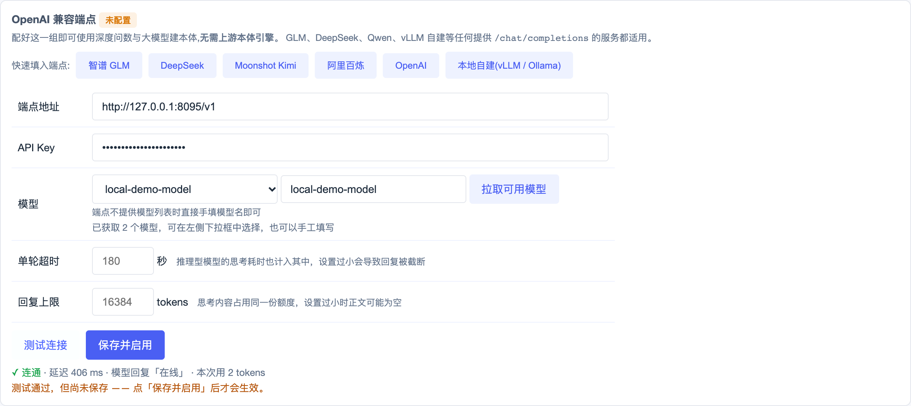
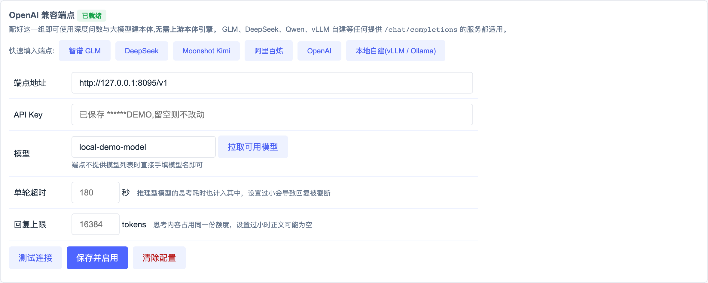

# 教程:接大模型 → 会话式建本体 → 基于本体问数

面向已完成安装的读者。全程所需时间主要取决于模型的响应速度。

前置:已按 [INSTALL.md](../INSTALL.md) 装好并能启动服务。不需要上游本体引擎。

文中的命令输出、构建产出和问数记录取自 2026 年 11 月 16 日在示例库(`examples/sample_db.sql`,6 张表)上的一次完整运行,
模型是经 OpenAI 兼容端点接入的 `deepseek-flash`。模型的输出每次不同,换一个模型差别更大;
这些记录用来说明各步骤做了什么,不是性能指标。

---

## 一、接入大模型

### 1.1 智谱 GLM

在 [智谱开放平台](https://open.bigmodel.cn/) 申请 API Key 后,打开「运维管理 → 引擎设置」,
在“OpenAI 兼容端点”卡片中填写下列项目。



| 字段 | 填写内容 |
|---|---|
| 端点地址 | 点「智谱 GLM」按钮填入 `https://open.bigmodel.cn/api/coding/paas/v4` |
| API Key | 平台申请的 Key |
| 模型 | 点「拉取可用模型」后在下拉框里选,或手工填写模型名 |
| 单轮超时 | 留空用默认 180 秒 |
| 回复上限 | 留空用默认 16384 |

点击“测试连接”可查看回复、延迟和用量。下图为本机演示端点的连通性测试。



确认连通后点“保存并启用”，检查端点状态是否为“已就绪”。



> **回复上限不要设得太小。** 推理型模型先输出思考内容再输出正文,两者共用同一份 token 额度。
> 上限过小时思考还没结束额度就用完了,正文为空;界面这时提示「回复被额度截断」。

### 1.2 OpenAI

在同一张卡片上改三项:

| 字段 | 填写内容 |
|---|---|
| 端点地址 | 点「OpenAI」按钮填入 `https://api.openai.com/v1` |
| API Key | `sk-` 开头的 Key |
| 模型 | 拉取后选择,或手填如 `gpt-4o` |

> OpenAI 官方端点的连通性没有在本机验证过(所在网络无法直连 `api.openai.com`)。
> 配置方式与上面相同;使用代理时,把端点地址填成代理的兼容地址。

### 1.3 用环境变量配置（适合容器部署）

```bash
export DATAMIND_LLM_BASE=https://open.bigmodel.cn/api/coding/paas/v4
export DATAMIND_LLM_KEY='替换为模型服务的 API Key'
export DATAMIND_LLM_MODEL='替换为端点提供的模型名'
export CLAW_DRIVER=openai
export DATAMIND_LLM_MAX_TOKENS=16384
python3 server.py
```

检查是否生效:

```bash
curl -s http://127.0.0.1:8092/api/ont/runtimes
# {"current":"openai","current_ready":true,"runtimes":["openai"]}
```

`current_ready` 为 `false` 时,同一份响应里的 `hint` 会写明缺什么。

---

## 二、会话式构建本体

「本体构建」页是一个对话式的构建工作台:用自然语言描述要建什么,
系统按「取证 → 模型提出候选 → 语义评审 → 数据验证 → 验收检查」的顺序产出本体,每一步的结果都显示在对话里。

### 2.1 选数据源、描述目标

左侧选数据源(示例主库,或自己接入的库),在输入框写明建模目标,例如:

> 围绕销售订单、产品与生产产出,建一张制造运营本体

给本体起个名字,点「构建 ▸」。

### 2.2 构建过程

本次运行全程 12 秒,共 14 步。主要步骤如下(完整的步骤清单见 `docs/pipelines/ontology_build.yaml`):

```
✓ intake            接收构建诉求 · 数据源「示例主库」· 编排技能 0 个
✓ intent            意图解析 · 目标本体「教程本体」
✓ gather_evidence   取证:库表 6 张
✓ llm_extract       LLM 抽取 · 对象 6 个 · 提议关系 6 条
✓ semantic_review   语义评审:6 通过 · 0 存疑(建议人工复核)
✓ relation_triage   候选分流 · 自动驳回 1 条 · 无数据暂缓 0 条 · 待人工审阅 0 条
✓ critic            验收检查:待复核 · 阻断问题 0
✓ verify            关系数据验证 · verified 5 条
✓ narrate           生成本体说明 · 287 字
```

> 这次运行之后,构建在「数据目录」之后加了两步:`data_grounding`(数据接地,DR-136)和 `arithmetic_witness`
> (算术见证,DR-135),所以现在的步骤数比上面多两步。示例库的表名、列名都是可读的英文名,又没有提供业务问题,
> 数据接地这一步只做取值画像,不调用模型。

模型提出了 6 条关系,5 条通过数据验证,标为 `verified`。剩下的一条是产品表的 `prod_line_id` 指向产线表的 `line_id`:
两列取值重叠 100%,但键名词根不一致,数据验证没有把它标为已验证,候选分流又依据已有证据把它驳回,没有进入图谱
(在「本体评审」页的「构建时被分流移出图谱的关系」里可以看到,也可以加回为人工断言)。

各环节的分工:

| 环节 | 执行者 | 产出 |
|---|---|---|
| 抽取 | 大模型 | 提出候选对象与关系 |
| 语义评审 | 大模型 | 只依据表结构判断语义是否合理,排除取值范围碰巧重合的情形 |
| 数据验证 | 确定性代码 | 用实际数据验证;只有这一步能把关系标为 `verified` |
| 候选分流、验收检查 | 确定性代码 | 驳回证据不成立的候选,给出通过、待复核或不通过的结论 |

对象和关系的数目每次运行都可能不同:模型的提议不确定,有时还会按行业常识补出库里没有对应表的实体
(如停机记录、质量检验记录)。判定标准是固定的:没有数据支持的关系不会成为 `verified`,问数生成的 SQL 也不能使用它们。

### 2.3 产出的本体

```
对象:客户、产品、生产线、销售订单、生产产出记录、生产日报汇总

销售订单       → 客户         verified
销售订单       → 产品         verified
生产产出记录   → 生产线       verified
生产产出记录   → 产品         verified
生产日报汇总   → 生产线       verified
```

6 个对象分别对应示例库的 6 张表(`dim_customer`、`dim_product`、`dim_production_line`、
`fact_sales_order`、`fact_production_output`、`dws_production_daily`)。

对象带有中文名,这是会话式构建相对于 `quick_build` 的主要差别。
`quick_build` 只从表结构推断,产出的对象名就是英文表名;中文名要由模型或人工补充。
中文名决定了后面问数时中文问句能否匹配到对象。

---

## 三、基于该本体问数

在本体图谱页选中刚建的本体,点「基于此本体问数」进入深度问数页;
也可以在问数框下方的「数据源」里选择它。

问一个业务问题:

> 最近几个月毛利率的变化趋势

本次运行约 6 秒返回,模型做了三个分析(整体、分产品线、分区域),三条查询都通过了本体约束校验:

```
✓ exec_sql   最近6个月毛利率月度趋势 → 6行
✓ exec_sql   各产品线毛利率月度趋势 → 30行
✓ exec_sql   各区域毛利率月度趋势 → 30行
```

| 月份 | 毛利率 % |
|---|---|
| 2025-12 | 34.40 |
| 2026-01 | 33.85 |
| 2026-02 | 34.52 |
| 2026-03 | 34.10 |
| **2026-04** | **14.97** |
| **2026-05** | **14.71** |

4 月起毛利率大幅下降。这是示例数据里预先构造的现象(见 `examples/sample_db.sql`),
用来确认问数读到的是库里的实际数据。依据卡上显示「实际取数截至 fact_sales_order.order_date 最新 2026-05-31」。

毛利率的数值是稳定的,结果集的列和呈现方式每次不一定相同:
模型有时一并选出金额、成本和毛利额,有时只给月份与毛利率;有时按百分数给 34.40,有时按小数给 0.3440。

### 3.1 查看本体在这次分析中的作用

对话区顶部的一行显示本次分析用到的本体范围:所用的本体、进入规划的候选表数、SQL 实际使用的表数和 JOIN 数。
SQL 实际使用的部分要等查询执行完才显示。

点「查看约束说明」可以看到:

- **SQL 最终直接使用**:FROM 和 JOIN 中实际出现的表;
- **为什么选入规划上下文**:每张候选表的入选原因(问题直接命中、关系扩展候选、默认候选、分析主表候选);
- **关系在本次分析中的作用**:每条候选连接依据的来源和状态,以及关系图。

点「在图谱中定位」跳到图谱页,本次用到的对象着色,其余淡出。界面截图见 [QUICKSTART.md](../QUICKSTART.md) 第 6 节。

### 3.2 中文问句怎样匹配到对象

中文问句不做分词。系统用本体自己的词汇
(对象中文名、业务别名、属性名、指标名,以及术语词典给出的中英文对应词)作为词典,在问句里查找。
这样不依赖分词器,结果是确定的,给对象补充的中文名和别名也会参与匹配。

同一个本体上三种问法的匹配情况(本次运行):

| 问法 | 直接命中的对象 | 命中的词 |
|---|---|---|
| 各产品的销售订单金额 | 销售订单、产品等 5 个 | 销售订单 ←「订单」、amount、sales;产品 ←「产品」、product |
| 销售订单 金额 排名 | 销售订单 1 个 | 「销售订单」、amount、sales、order |
| 最近几个月毛利率的变化趋势 | 无 | 无 |

第一行里生产线、生产产出记录、生产日报汇总也被命中,原因是「产品」经术语词典对应到 prod / product,
而这几张表的列名里含有这些词。直接命中的范围因此偏宽,但不影响结果。

第三行没有命中,因为这个本体里没有名为「毛利率」的对象或别名。
毛利率是由订单金额和成本计算出来的派生指标,不是对象名。
没有命中时,系统把全部候选表交给模型,答案仍然正确,只是候选范围没有缩小。

解决办法是在「本体对话」页给相关对象补充业务别名(见第四节)。

指标名也参与匹配(「指标中心」列出的就是本体里已登记的指标)。
指标随本体构建产出,当前界面上只能查看和确认,不能新增;
要增加指标,需要在构建时产出,或接入上游引擎后用 `set_metric` 操作绑定。

> 单字不参与匹配:「的」「和」这类字在问句里很常见,用它们匹配会把无关的表带进上下文。

### 3.3 本体约束校验

SQL 执行前做三项检查:表必须在本体范围内;JOIN 键必须落在 `verified` 或 `asserted` 的关系上;
关联后的聚合不能重复计数。下面这个问题会同时触发后两项:

> 按产品所属的生产线统计销售订单金额

本次运行的执行记录:

```
✗ ontology_gate  本体约束拦截:JOIN 键 dim_product.prod_line_id=dim_production_line.line_id
                 不在本体已验证关系上(关联未经数据验证,已拦截)(按原因修正一次)
✗ ontology_gate  本体约束拦截:扇出风险:SUM(fs.amount) 聚合的是 fact_sales_order 的列 amount,
                 而fact_sales_order 与 fact_production_output 都关联到 dim_product 的同一行,
                 fact_sales_order 的每一行会按 fact_production_output 的行数重复(已拦截);
                 请把两边分别按 dim_product 的键聚合后再关联,或只关联其中一张
```

模型先把产品表和产线表直接关联。这条关系就是第二节里没有通过数据验证的那一条,校验拒绝了它,并让模型按原因改写一次。
改写后的 SQL 改走「销售订单 → 产品 ← 生产产出记录 → 生产线」。连接键都在已验证的关系上,
但销售订单和生产产出记录同时关联到产品,每一笔订单金额会按该产品的产出记录数重复累加,所以第二项检查又拒绝了它。
这个问题最后没有给出数值,依据卡上列出了被拒绝的查询和原因。

本体里确实没有「产品属于哪条产线」的已验证关系,拒绝作答是正确的结果。
要让这个问题能回答,需要先在「本体评审」页把那条关系加回为人工断言(状态为 `asserted`)。

拦截不是每次都出现:模型没有使用未经验证的关联、也没有写出会重复计数的聚合时,查询直接通过。

### 3.4 「意图一致」检查

执行记录里还有这样一行(取自问题「各产品的销售订单金额」):

```
✓ intent_crosscheck  意图一致 · SQL 覆盖了问句锚定到的 2 个业务对象(产品、销售订单)
```

这是双盲意图检测:两侧互不参照,一侧只读问句,另一侧只读 SQL,各自得出涉及哪些本体对象,再做比对。
两侧都不调用模型,避免用模型检查模型带来的同源偏差。

这项检查的范围有限:问句一侧只识别本体里有的词。问「最近几个月毛利率的变化趋势」时,
问句没有匹配到任何对象,这一行显示的是「意图无法比对 · 问句未锚定到本体对象」,不作判断。
「一致」指 SQL 查询的确实是问句匹配到的那几个对象,不表示问句里的每一项都得到了回答。

---

## 四、对话式修改本体

上一节里业务用语匹配不到对象的问题,用这一节的办法解决。

进「本体对话」页,选中要修改的本体,先填写署名(修改会记入操作记录),然后用自然语言提出要求。

### 4.1 助手提出建议,由人确认后写入

先问一个只读的问题:

> 这张本体里有哪些对象?

本次运行列出了六个对象。下面保留当时测试别名编辑时使用的指令。它把产能和实际产量混用，第 4.2 节说明如何按字段口径纠正。

> 给「生产日报汇总」加两个业务别名:产能、产量

助手的回复里带一条建议的编辑操作:

```json
{"op": "set_alias", "target": "obj:生产日报汇总",
 "params": {"aliases": "产能,产量"},
 "reason": "用户要求为「生产日报汇总」增加业务别名，便于业务用语与本体对象对齐"}
```

这时本体还没有改动。界面上出现确认按钮,点击后才写入;写入时同时记录操作人和理由。

> 助手用中文名指代对象(`obj:生产日报汇总`),而对象的主键是表名(`dws_production_daily`)。
> 系统按主键、中文名、表名、业务别名依次定位,任何一项匹配即可,所以可以直接确认助手的建议。

### 4.2 按字段含义复核别名

在这次历史测试中，给“生产日报汇总”加入“产能”后，问“车间近期产能怎么样”确实能命中该对象，但命中的表记录的是实际产量。若确认这项编辑，后续回答就可能把已完成的生产量当成产线能力。

六表示例的 `dim_production_line.capacity` 是产线的日产能（台），`dws_production_daily.qty_actual` 是各产线当日的实际产量。“日产能”应指向产线的能力字段，“日产量”才适合作为生产日报汇总的检索用语。复核时应先查看绑定字段、单位和统计粒度，再决定是否接受建议。[示例表结构](../examples/sample_db.sql)

### 4.3 撤销

改错了点「撤销」,或调用 `POST /api/ont/undo`。编辑以日志形式追加,撤销即回退最后一条,
原始 IR 文件不变,所以每一步都可以恢复。本次运行撤销上面的别名后,同一句问法又回到没有命中的状态。

> **可用的编辑操作**(只接受下列操作,其他请求不执行):
>
> | | 算子 | 说明 |
> |---|---|---|
> | 不接引擎即可用 | `set_alias` `confirm` `remove_object` `verb` `set_card` `add_relation` `remove_relation` `confirm_relation` `reject_relation` `confirm_semantic` `reject_semantic` | 别名、人工审核、动词与基数、增删对象与关系、业务语义确认 |
> | 需接上游引擎 | `rename` `set_kind` `set_metric` `add_object` `add_attribute` `remove_attribute` | 改名、改类型、绑指标、增属性 |
>
> 人工审核只产生 `asserted`,不会把关系标成 `verified`;`verified` 只由数据验证得出。

---

## 五、两种建本体方式怎么选

| | 纯数据驱动 `quick_build` | 会话式构建 |
|---|---|---|
| 需要大模型 | 否 | 是 |
| 耗时（6 张表） | 数秒 | 取决于模型,本次运行 12 秒 |
| 对象命名 | 英文表名 | 中文业务名 |
| 关系来源 | 只有数据能直接验证的关系 | 模型提出候选,再做数据验证 |
| 建模意图 | 无 | 可用自然语言指定 |
| 适用 | 快速了解库里有什么 | 用于问数,或需要给业务人员阅读 |

两种方式的 `verified` 判定标准相同,都只由数据验证决定。

两种方式建出的本体,都可以用第四节的对话方式继续修改。

---

## 常见问题

**测试连接返回「回复被额度截断」** — 回复上限设得太小。推理型模型的思考内容占用同一份额度,
调大到 4096 以上再试。

**建本体时 `llm_extract` 失败** — 多数是超时。推理较慢的模型在这一步可能需要几分钟,
表越多越久;把单轮超时调到 300 秒以上。

**问数 SQL 报 `no such column`** — 问数用的不是刚建的本体。
在本体图谱页选中它,点「基于此本体问数」。

**关系大部分是 `candidate`** — 这些关系的证据不足以标为已验证。到「本体评审」页逐条审核,
确认后状态变为 `asserted`,问数的本体约束校验会接受它们。

**中文问句命中不了对象** — 本体缺中文名或业务别名。
到「本体对话」页给对象加业务别名(见第四节),不接引擎也可以做。
「术语管理」页展示的英中词典来自 `translate_cn.py`,只读;扩充它需要改代码,一般没有必要。
