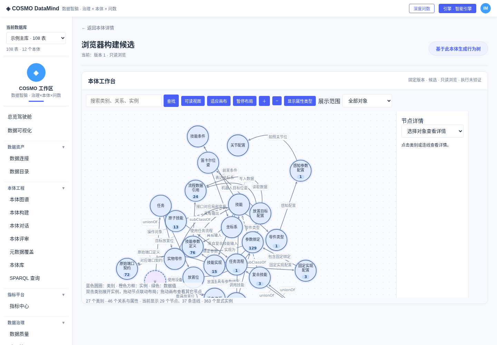

# IR-031 T06 · Studio 机器人可视化交付 — DR-159

日期：2026-11-17。
分支：`feat/studio-ui-integration`。
状态：delivered；按用户“继续完成本次 IR 剩余的任务，不用等我 review”的明确授权完成技术交付，不冒称另有人工验收。

## 交付行为

机器人设计使用持续存在的 Studio 画布，类别生成、关系／属性补充和固定实例产物按真实保存结果更新。
默认可读视图保持标签字号；可平移查看其它区域或“适应画布”查看全图。
拖拽联动、固定／释放、暂停、双击展开、属性与实例详情、50 条分批、分页到最后实例及历史只读切换已接入。
已保存新旧本体的默认目录入口使用相同画布，原 relations 深链保留兼容；数据本体 Studio 接入属于 IR-032。
普通浏览、搜索和展开不调用模型，不确认或发布本体，不改固定版本。

## 当前代码完整验证

标准命令：`.venv/bin/python scripts/check.py --suite all --report-dir .check-results/IR-031/acceptance-final`。
仅测试子进程 PATH 补充已有 Playwright Node 路径，没有安装运行时、修改系统 PATH 或调用真实外部模型。
最终 17 个检查阶段全部退出 0；完整运行报告位于上述本地忽略目录。
机器摘要见 [T06 results](IR-031-t06-results.json)。

| 检查 | 结果 |
|---|---|
| 单元／场景／规约 | 3803 passed，5 原有可选上游平价跳过，0 failed；3538.40s |
| lint／mypy | 通过 |
| 整体／核心／路由覆盖率 | 83.0%／88.1%／73.4%，既有门槛保持 |
| HTTP 集成 | 536 通过，0 失败，6 条件跳过 |
| 严格本体验证 | 10／10 轮通过 |
| UI 走查／操作 | 47／48 通过，0 失败；操作中 3 项未配置真实模型端点的原有跳过 |
| 机器人构建／评审／任务／设计浏览器 | 19／16／12／29 项通过 |
| Studio／固定版本详情浏览器 | 7／29 项通过 |

702 份源码、测试和配置在验证开始与结束的 SHA-256 完全一致。
校验清单见 [输入摘要](IR-031-t06-inputs.json)，机器摘要保存其文件摘要。
验证后只更新规约交付状态、验收元数据及交付记录，产品代码和测试断言保持本次通过版本。

## 交互、视觉和规模证据

Chrome 156.0.8078.47，Intel Core Ultra 9 285K，24 logical CPU，桌面 1440×1000 和窄屏 390×844。
预热后各 5 次，以最大值作为约定 p95：30 类／60 边场景 31.1ms，150 节点／300 边场景 214.6ms，均满足 T01 的 2s／5s 限额。
真实鼠标拖拽验证邻居联动、固定节点保持位置和下一帧响应≤100ms；暂停／释放、搜索、缩放与键盘详情入口通过。
1000 实例场景通过双击和实际按钮访问到第 951～1000 项，显示准确范围与总数；空类别明确说明。
20 次挂载／更新／销毁后，受测动画、ResizeObserver 和 DOM 内容归零；独立多画布标识及事件清理由 Node 行为测试共同守护。
页面没有未捕获错误。
模型交互使用本地脚本化边界和真实服务／持久化流程，不等同于真实模型质量或硬件执行验证。

## 本轮修正与失败证据

- 视觉复核修正默认全图缩放导致标签偏小的问题，增加默认可读视图与全图切换，并把新样式／SVG 标注字号统一至少 12px。
- 历史选择期间晚到的固定产物响应只缓存，不覆盖历史；切回当前仍可显示完整产物。
  在旧逻辑上先复现浏览器失败，再在相同断言下验证修复；测试只延迟真实服务响应，不伪造响应内容。
- 全量暴露旧事务故障测试的跨库注入污染：它全局补丁命中了其它测试后台调度器，导致多次注入。
  现限定到该测试自己的 Storage.root，保留单次注入、完整回退和工件索引不变的原断言；54 项交叉回归及最终全量通过。
- T02 的六项 Node 启动失败曾被误记为产品 RED，已在 T03 明确更正并保留原始资料；未删原报告或跳过测试。
- 两条旧浏览器“无修订选择器”断言按 DR-159 的历史图谱需求更新为只读历史检查，原数据库／模型／版本不变断言保留并补强。
- 早期运行因视觉、字号或已确认失败被主动中断，只用于诊断；不作为当前代码完整通过证据。

## 提交与使用

T01～T05 分别提交为 `4905b5f`、`808f943`、`ee5160b`、`250973c`、`a94a246`。
T06 提交包含最终可读视图、字号、历史竞态、故障测试隔离修正及本交付记录。
参见 [使用说明](../studio-robotics-guide.md)、[视图契约](../../specs/contracts/studio-graph-view-v1.md)。
本轮未修改用户数据或重启用户服务；运行服务需重新加载后才能使用新增接口。
