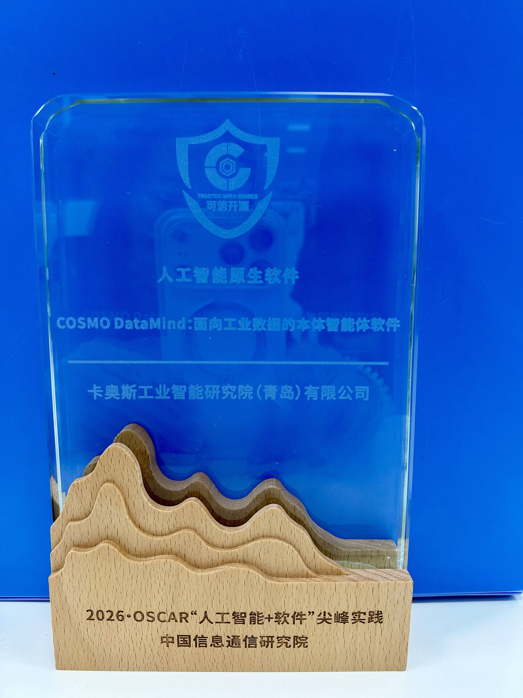
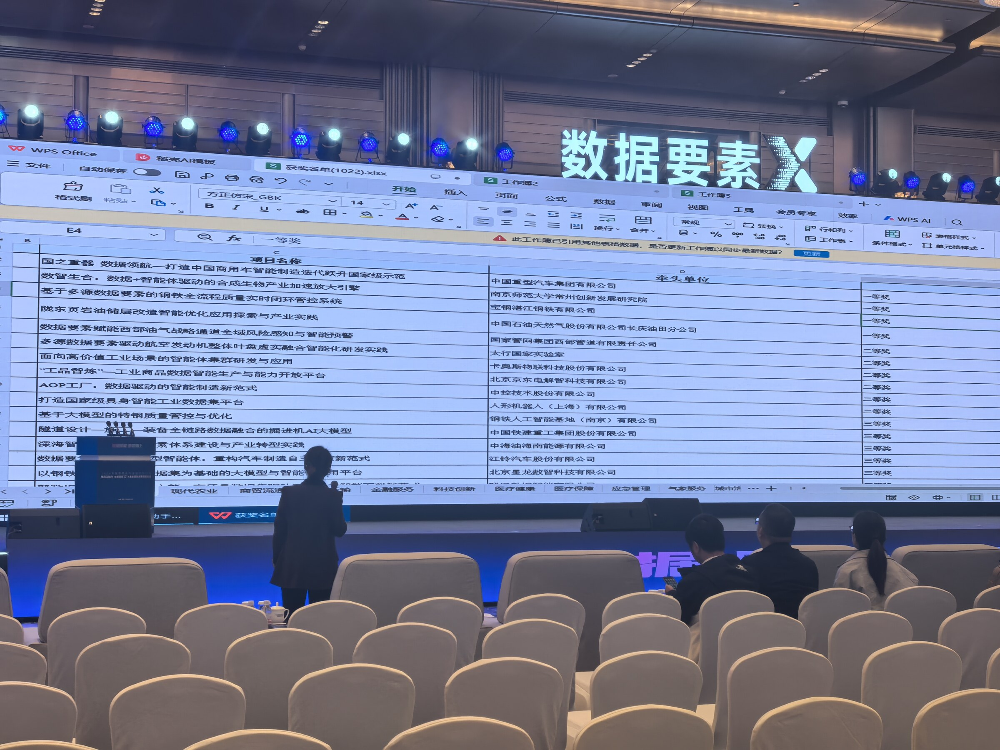

# 项目获奖与应用案例

[项目首页](../../README.md) · [文档目录](../README.md)

## 2026 OSCAR“人工智能+软件”尖峰实践

“COSMO DataMind：面向工业数据的本体智能体软件”入选“人工智能原生软件”类别。奖牌列明项目名称及单位“卡奥斯工业智能研究院（青岛）有限公司”，底座署名中国信息通信研究院。2026 OSCAR 开源产业大会于 11 月 10 日在北京举行。[大会报道](https://www.ncsti.gov.cn/kjdt/xwjj/202611/t20261112_262952.html)

## 2026 年“数据要素×”大赛全国总决赛

**“面向高价值工业场景的智能体集群研发与应用”获工业制造赛道二等奖。** 项目由卡奥斯物联科技股份有限公司牵头，卡奥斯工业智能研究院（青岛）有限公司等单位参与。COSMO DataMind 用于该项目的工业本体半自动构建。获奖公示中，项目列在工业制造赛道第 7 项。[国家数据局获奖公示](https://www.nda.gov.cn/sjj/zwgk/tzgg/1024/20261024184710828836536_pc.html) · [获奖项目明细](https://dexc.data.beijing.gov.cn/xwzx/tzgg/151cf6c650ac45328855f20d2c8f67d9.html)

