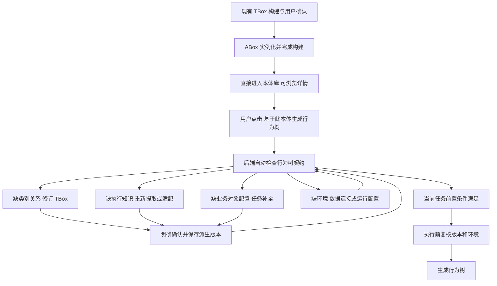

# DataMind 通用本体与应用契约优化方案

日期：2026-11-12。状态：proposed，供评审；未修改产品代码、数据库或现有本体。依据用户六项要求和昨日讨论稿，后者作为背景资料，其“构建时选择场景／约束 TBox”建议由本次用户明确方向替代。

## 设计结论

本体构建沿用现有 TBox＋ABox 流程及 LLM／离线路径：完成类别、关系、属性等既有确认步骤和 ABox 实例化后，构建成功的本体直接进入本体库。允许其对某个应用不完整；不增加“选择应用／匹配契约”环节，不以应用契约作为入库条件。

用户在该本体详情页点击“基于此本体生成行为树”时，才表示开始使用行为树应用。按钮直接进入对应流程，后端自动确定行为树契约并检查当前版本，无需用户再选择应用或契约。不满足时定位缺项并引导补全；补全显式保存新版本，返回原行为树任务复检，满足本次生成条件后才执行生成。仅入库、浏览本体库或打开详情页均不触发应用契约检查。

本体版本与应用是多对多关系。领域和载荷决定提供哪些应用操作入口，点击具体操作后才检查执行条件。机器人本体不会因尚未通过行为树契约就隐藏或禁用该入口；检查结果约束真正的生成操作。应用契约不等于本体 schema，也不等于指标口径或现场执行验证。

## 现状与六项需求的对应

| 需求 | 已核对的现状 | 改进 |
|---|---|---|
| 通用本体允许不全 | IR-024 设计候选已与 UR 消费资格分开；提取可以报告遗漏 | 保留 TBox＋ABox 流程，完成即入库；不预选应用、不检查应用契约 |
| 应用检查和修复 | 机器人 compatibility 多返回笼统 unsupported；已有 UR 消费及任务缺项机制 | 点击生成行为树入口后检查，统一报告并分层引导补全 |
| 后端契约配置 | 规则散落各消费者 | 固定代码注册表和版本化配置；前端只展示 |
| 数据本体和问数 | 可查询表预检、SQL 本体锚定、指标契约、只读执行已存在 | 增加适配器，保留原关卡和兼容回退 |
| 删除本体 | 数据构建页面已有 × 与 /api/build/delete，直接删除文件；机器人仅有实体删除 | 统一资产逻辑删除、恢复、引用检查和历史保留 |
| 新本体详情 | TBox/ABox 已显示，但密集表格和高级信息占据主要空间 | 统一视觉组件、分栏导航、摘要与可操作缺项 |

核对代码：`server.py:952` 的 `_anchor_ir`，`:1031` 的 `_qa_graph_profile`，`:1071` 的 `_qa_anchor_ir`，`:1093` 的 `_qa_scope_error`，`:1429` 的 `_qa_validate_sql`，`:3593` 的同步问数和 `:3678` 的 SSE；`server.py:5013` 的删除接口；`metric_contract.py` 与 `bp_metrics.py`；`ontology_assets/robotics_design.py`；`domains/robotics/task_knowledge.py`、`consumer.py`、`semantics.py`；`ui/modules/robotics-assets.js`。
行号为本次检查定位，后续可能变化，以函数名为准。

## 组件与数据边界

建议新增 application_contracts 包，提供注册、只读检查、问题协议和应用适配器。契约声明 application_id、version、可接受的领域和载荷、检查器与修复器标识。配置仅由后端维护，不包含任意脚本、客户端路径、密钥或模型生成代码。

评估服务从已选资产版本读取不可变快照；机器人保留 RDF，数据本体保留 JSON IR。旧数据 graph key 通过适配器读取包含人工编辑的有效 IR；多图使用完整有序版本／摘要向量，不用一个版本号冒充全部来源。

应用入口绑定确定的 application_id；后端验证该绑定，不让用户填写或挑选契约。行为树按钮进入检查与任务准备流程，实际生成请求仍须通过检查。应用执行器调用现有行为树生成器或问数编排。新契约报告解释入口资格，现有执行前校验继续作为最终守卫；不能以一次缓存的 ready 绕过它。

## 检查结果与任务状态

| 层 | 机器人应用 | 深度问数应用 | 修复入口 |
|---|---|---|---|
| schema | 类别、关系方向、角色对应 | 对象、表／列绑定形状 | TBox 设计／数据本体评审 |
| execution | 技能实现、顺序、端口、绑定、配置路径 | 可查询关系与指标表达、计划可解释性 | XML 提取与适配／绑定治理 |
| task | 本次工件、位置、配置和模式所需依据 | 当前问题涉及的 SQL、字段和口径 | 任务补全／问题澄清 |
| environment | 当前生成模式要求的依赖与证据状态 | 当前连接、表目录、访问能力 | 连接与运行设置 |

单项状态使用 passed、missing、unsupported、invalid、error、not_evaluated，severity 区分阻塞与警告。总体 ready 必须覆盖当前应用和当前生成模式的必需前置条件；未提供任务时 task=not_evaluated，仅能说“可进入任务准备”。通过生成检查不表示机器人已实际执行。

缺项示例：`schema.missing_role` 指向 TBox；`execution.binding_ambiguous` 指向源节点与调用；`task.missing_profile` 指向工件类型或槽位；`environment.table_unavailable` 指向连接。返回 expected、observed、evidence_refs 和 repair action。没有可用修复器时明确“暂不支持自动修复”，保留诊断详情。

## API 草案与持久化

接口为拟议契约，T01 冻结前不视为已实现；具体字段、错误和兼容边界见 [IR-025 T01 冻结契约](../specs/contracts/application-contracts-v1.md)：

- `GET /api/applications`：列出后端注册应用及版本，不执行模型。
- `POST /api/application-checks`：输入 entrypoint、版本引用和受限 context，由后端绑定 application_id 并产生固定检查记录。
- `GET /api/application-checks/<id>`：只读历史报告，包含是否过期。
- `POST /api/application-checks/<id>/repairs`：提交允许的 repair action、expected_revision、request_id 和用户输入；响应运行编号或补全会话。
- `POST /api/ontology-assets/<id>/deletion-preview`：只读影响预览。
- `POST /api/ontology-assets/<id>/delete`、`/restore`：携带资产 revision 和幂等编号执行生命周期变更。

检查记录包含 contract_version、asset_refs、payload_hashes、task_hash、environment_revision、checked_at、layer_results、issues 和 next_actions。环境变化后展示旧结果为 stale；执行必须重新获取有效环境。目录采用分页和有界缓存，只读已存在的历史检查摘要；没有报告显示“尚未检查”，不在构建完成、入库或浏览详情时自动检查。

修复记录关联原检查和父版本；最终本体的总 JSON 包含当前版本事实及设计／补全／适配血缘。检查运行可以有内部持久化记录，但不要求用户下载多个业务 JSON 拼装结果。旧 design v1 工件不就地迁移；新派生版本采用显式升级后的契约。

## 机器人应用的改造边界

复用现有提取器、词表、来源证据、模型设计会话、任务补全和编译校验。补上执行元数据、作用域、固定配置、公开参数和可证实的业务配置提取，并增加明确的角色映射与标准化适配器。

“llm自动构建”可作为诊断验收样例：已具备 26 类、360 实例，不等于应用就绪。先说明缺失的固定配置、scope、treeId/xmlTag 等执行结构；修复后再检查当前工件和槽位的配置关联。无法从来源确认的业务事实由用户补充，不预置示例工位或假设设备身份。

缺类可以修订 TBox，缺执行结构需要提取／适配；单纯新增业务对象不能补出流程。原始设计保持可查看；适配生成派生版本，重构标准身份时保存与原实例的映射，不形成两套可独立编辑的权威配置。

第一版仍是固定 UR 抓移放配置化生成。任意流程规划、新设备驱动、任意 OWL 自动转为执行本体留在范围外。离线候选和严格生成沿用原有差异，所有前置条件按选定模式判断。

## 深度问数兼容策略

已有 `_qa_graph_profile` 将存在至少一个可用绑定表视为 queryable，因此不能在新契约中要求所有表和全部指标均已认证。普通记录查询、单表统计不依赖指标契约；用到指标时保留原有消费分级。SQL 仍须满足只读、单语句、图谱锚定和口径检查。

数据本体同样保持原构建与入库流程；用户沿用现有深度问数入口发起问数时，由后端自动使用 data.deep_qa 契约，不新增应用选择向导。影子比对仅在实际问数请求链路中进行，再启用统一提示和执行前复验。同步与 SSE 共用检查器，保留旧响应和事件，新增结构化缺项。连接不可用转去接入／物化，表绑定缺失转去本体评审，问题歧义转去澄清。

未选图谱时默认 demo 与现有离线规划继续兼容。普通旧缺失 key 的有标注回退暂保留；已删除 key 明确拒绝，不回退 demo。缓存命中前检查生命周期和连接新鲜性，缓存键包含人工 edits 的有效摘要及多图完整向量。

## 删除和恢复

建议第一版采用可恢复的逻辑删除。默认目录与应用选择隐藏资产，历史版本、运行结果、来源和下载继续保留并标“已删除”。这不是磁盘清理；永久删除留待明确留存策略后单独设计。

预览引用影响后确认删除；有排队或运行任务时拒绝并提示完成后重试。受理和删除在同一事务边界检查，等待用户输入的会话冻结写入。恢复后清空能力缓存并重新检查。

旧 built 文件先建立有效快照与 alias/tombstone，旧删除接口委托统一服务。所有 raw 文件扫描、问数 key、目录注册、直接任务请求和缓存都必须识别 tombstone，防止资产重新出现。共享来源不级联删除，内置 demo 受保护。

## 详情页布局方案

首行：名称、领域、固定版本、构建方式；机器人详情保留“基于此本体生成行为树”主按钮，旁边放下载和更多操作。该按钮用于开始检查和任务准备，不要求预先通过契约。第二行：类别、关系定义、实例、实例关系四张摘要卡。主体标签：概览／类别与关系／实例／应用／来源与版本。

概览优先显示用途说明、覆盖摘要和已有检查记录（无记录显示“尚未检查”）；实例页提供类型筛选、搜索和分页；来源页展示来源文件和版本血缘；原始 JSON 放高级折叠区。应用区域仅展示已有使用记录和检查结果，不承担入库后的必选步骤，也不因打开页面自动检查。点击行为树主按钮后进入检查／补全界面，清晰区分“可准备任务”“缺执行知识”“本任务可生成”“检查已过期”；点击缺项进入对应修复环节并保留返回位置。

复用现有白底卡片、浅色背景、紫蓝主色及按钮组件，保持空状态、加载状态和错误状态统一。360 实例不一次全部渲染；窄屏转换为堆叠布局，状态兼有文字，关键操作支持键盘。删除放更多操作并显示影响确认。

## 独立 DR 与 IR

| 决策 | 迭代 | 交付范围 | 依赖 |
|---|---|---|---|
| [DR-071](../specs/decisions/DR-071-application-contract-registry.md) | [IR-025](../specs/iterations/IR-025-application-contract-registry.md) | 后端应用注册、分层检查与修复协议 | 先行 |
| [DR-072](../specs/decisions/DR-072-robotics-application-adaptation.md) | [IR-026](../specs/iterations/IR-026-robotics-application-adaptation.md) | 机器人执行结构适配和任务补全闭环 | IR-025 |
| [DR-073](../specs/decisions/DR-073-deepqa-application-compatibility.md) | [IR-027](../specs/iterations/IR-027-deepqa-application-compatibility.md) | 深度问数兼容适配和缓存新鲜性 | IR-025 |
| [DR-074](../specs/decisions/DR-074-ontology-asset-lifecycle.md) | [IR-028](../specs/iterations/IR-028-ontology-asset-lifecycle.md) | 统一资产删除恢复、旧 key 兼容 | 核心可并行，接 IR-025／027 |
| [DR-075](../specs/decisions/DR-075-ontology-detail-experience.md) | [IR-029](../specs/iterations/IR-029-ontology-detail-experience.md) | 详情页、行为树操作入口和修复导航 | 布局可先行，动作接前四项 |

每个 IR 分契约评审、核心 RED/GREEN、HTTP/UI RED/GREEN、全量回归及人审交付。验收共 21 条；IR-025 T03 核心测试已转绿；T05 集成实现及全量回归通过，登记为 created-green-partial；T06 完成，IR-025 已于 2026-11-12 获用户确认 delivered，其余 17 条保留 planned_requirements，不声称功能通过。
System Design Word 文档保留方案阶段概要，实施进度与测试状态以各 IR 和验收映射为准。

## 验证与运维

以旧数据问数、旧 UR 任务和当前真实新本体三类样例建立基线。覆盖缺类别、缺绑定、任务缺项、连接失效、缓存过期、删除竞态、来源损坏、重复修复、重启和历史下载。检查耗时、缓存命中、各层缺项、修复结果和执行拒绝原因只记录必要摘要，不记录模型密钥。

迁移先备份并在副本演练；新记录增量落库，旧工件不改写。应用适配器按后端开关灰度，关闭 UI 不关闭执行守卫。一次通过结果不永久授予资格，发布和生成执行端均复核。保留原部署模型，暂不引入多租户或分布式调度承诺。

## 待评审取舍

建议确认五个 DR 的范围，以及删除第一版采用逻辑删除、机器人先覆盖现有固定抓移放、契约只由后端维护。性能指标在基线测量后冻结，不在方案阶段虚构延迟或成功率承诺。

原讨论稿不修改。System Design 模板文件作为版式依据，独立 DR/IR Markdown 作为实施与验收依据；二者不表示已开始代码实现。

IR-025 当前使用与 API 见 [使用说明](application-contracts-guide.md)，交付证据及范围见 [T06 评审](audits/IR-025-t06-delivery-review.md)。
