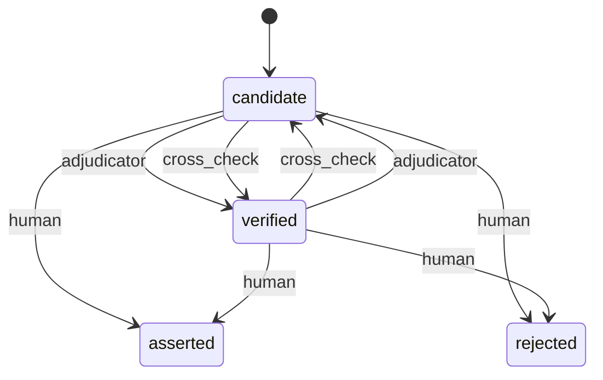
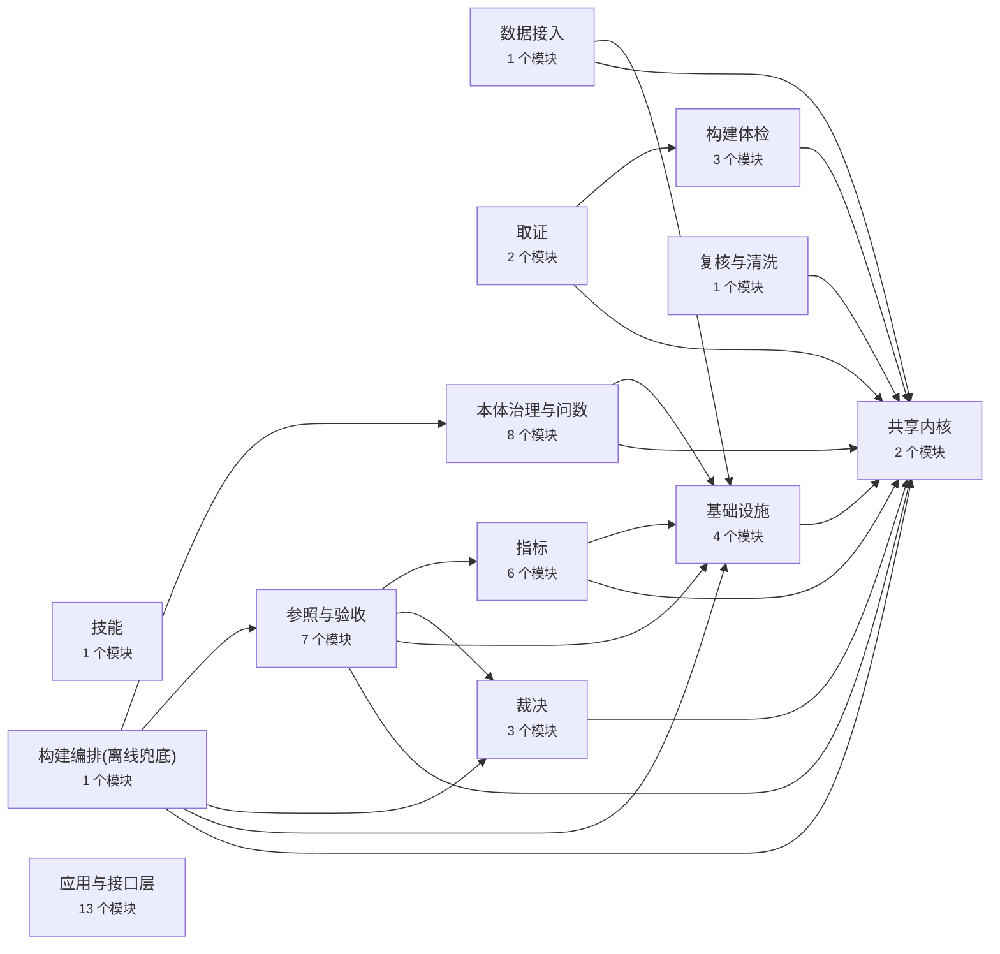

# 模型投影(自动生成,勿手改)

> 由 `python3 scripts/gen_models.py` 从模型生成。改模型后重新生成;`tests/meta/test_models.py` 会检查本文件是否同步。

## 构建流水线(docs/pipelines/ontology_build.yaml)

每个节点下的小字是它对外推送的步骤名(SSE),与构建代码一一对应。

```mermaid
flowchart TD
    intake_scope_and_cq["intake_scope_and_cq<br/><small>scope_source · intake · cq_holdout · intent · round_scope · scope_base</small>"]
    skill_discovery["skill_discovery<br/><small>orchestrate · skill_inject</small>"]
    reference_profile["reference_profile<br/><small>reference_profile</small>"]
    reference_asset_load["reference_asset_load"]
    evidence_manifest["evidence_manifest<br/><small>gather_evidence · long_doc</small>"]
    code_contracts["code_contracts<br/><small>code_contracts</small>"]
    concept_hints["concept_hints<br/><small>concept_hints</small>"]
    proposal[/"proposal<br/><small>llm_extract · relation_intake</small>"/]
    stability_probe["stability_probe<br/><small>stability</small>"]
    semantic_review[/"semantic_review<br/><small>semantic_review</small>"/]
    data_adjudication["data_adjudication<br/><small>verify · verify_diagnosis</small>"]
    complete_sql_evidence["complete_sql_evidence"]
    adjudication_core["adjudication_core"]
    quick_build_fallback["quick_build_fallback<br/><small>construct</small>"]
    mapping_enrichment["mapping_enrichment<br/><small>concept_families · code_labels</small>"]
    action_projection["action_projection<br/><small>action_projection</small>"]
    iteration_merge["iteration_merge<br/><small>merge</small>"]
    upper_relation_grounding["upper_relation_grounding"]
    reference_annotation["reference_annotation"]
    metric_mining["metric_mining<br/><small>metric_mining</small>"]
    metric_adjudication["metric_adjudication<br/><small>metric_adjudication</small>"]
    cross_check_and_cleaning["cross_check_and_cleaning<br/><small>cross_check · data_clean</small>"]
    quality_health["quality_health"]
    quality_evidence["quality_evidence"]
    quality_metric["quality_metric"]
    quality_definition["quality_definition"]
    quality_cq["quality_cq"]
    quality_aggregate["quality_aggregate<br/><small>critic</small>"]
    persist_audit[("persist_audit<br/><small>narrate</small>")]
    human_review_feedback(["human_review_feedback"])
    intake_scope_and_cq --> reference_profile
    reference_profile --> reference_asset_load
    reference_asset_load --> skill_discovery
    skill_discovery --> evidence_manifest
    evidence_manifest --> code_contracts
    code_contracts --> concept_hints
    concept_hints --> proposal
    proposal --> semantic_review
    proposal --> stability_probe
    proposal --> data_adjudication
    data_adjudication --> adjudication_core
    data_adjudication --> complete_sql_evidence
    quick_build_fallback --> complete_sql_evidence
    complete_sql_evidence --> adjudication_core
    proposal --> quick_build_fallback
    adjudication_core --> mapping_enrichment
    quick_build_fallback --> mapping_enrichment
    mapping_enrichment --> action_projection
    action_projection --> iteration_merge
    iteration_merge --> upper_relation_grounding
    upper_relation_grounding --> reference_annotation
    reference_annotation --> metric_mining
    metric_mining --> metric_adjudication
    metric_adjudication --> cross_check_and_cleaning
    cross_check_and_cleaning --> quality_health
    quality_health --> quality_evidence
    quality_evidence --> quality_metric
    quality_metric --> quality_definition
    quality_definition --> quality_cq
    quality_cq --> quality_aggregate
    quality_aggregate --> persist_audit
    persist_audit --> human_review_feedback
```

## 关系状态机(specs/models/relation_lifecycle.json)

## 限界上下文(specs/models/context_map.json)

| 上下文 | 标识 | 模块 | 允许依赖 |
|---|---|---|---|
| 共享内核 | `shared_kernel` | ontology_domain、ir_shape | — |
| 基础设施 | `infrastructure` | srv_context、store、sqlite_evidence、observability | shared_kernel |
| 数据接入 | `source_access` | ext_sample | shared_kernel、infrastructure |
| 构建体检 | `preflight` | build_prep、concept_hints、doc_chunks | shared_kernel |
| 取证 | `evidence` | code_contracts、llm_json | shared_kernel、preflight |
| 裁决 | `adjudication` | dao_core、ontology_grounding、content_quality | shared_kernel |
| 参照与验收 | `acceptance` | build_quality、build_references、standard_assets、cq_check、health_check、definition_eval、hallucination_eval | shared_kernel、infrastructure、adjudication、metrics |
| 复核与清洗 | `cross_check` | build_cleaning | shared_kernel |
| 指标 | `metrics` | metric_contract、metric_mining、metric_pipeline、concept_profile、ir_relational、osi_export | shared_kernel、infrastructure |
| 本体治理与问数 | `governance` | intent_check、usage_stat、drift_check、compat_check、module_split、rule_engine、action_ontology、translate_cn | shared_kernel、infrastructure |
| 技能 | `skills` | skill_registry | — |
| 构建编排(离线兜底) | `build_orchestration` | quick_build | shared_kernel、infrastructure、adjudication、acceptance、governance |
| 应用与接口层 | `application` | server、wsgi、bp_actions、bp_engine、bp_metrics、bp_semantic、srv_actions、srv_engine、srv_hardening、openai_runtime、mcp_action_server、mcp_build_server、gunicorn.conf | * |
