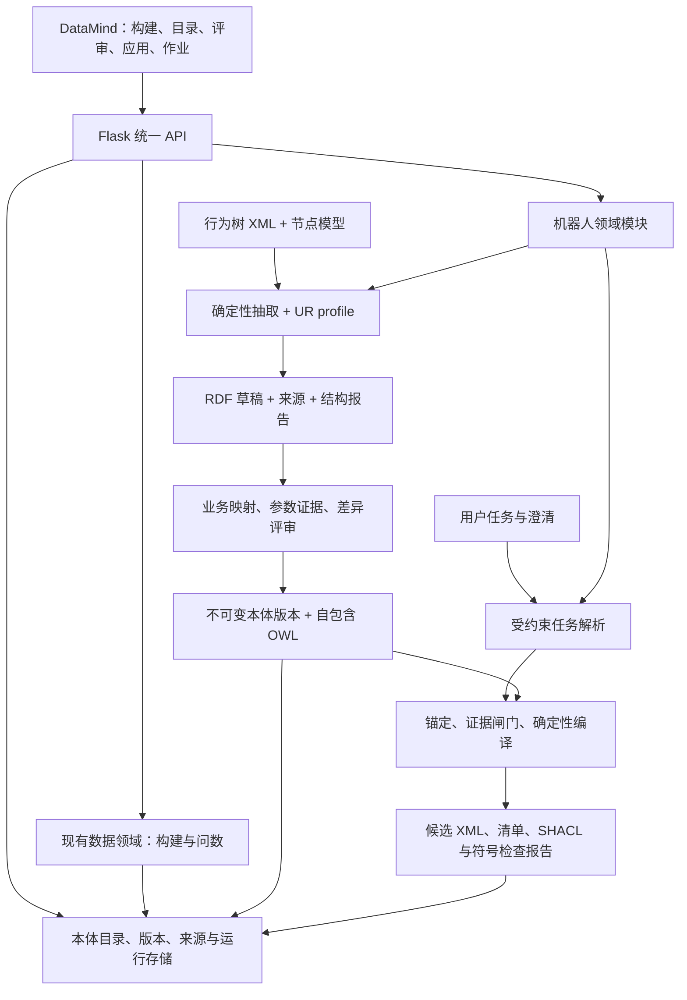

# PROPOSAL · DataMind 与 yang 本体构建及行为树生成深度集成

- **状态**：总体方案及跨阶段 DR 仍为 proposed；第一阶段 IR-016 已交付，第二阶段 IR-017 已于 2026-11-04 经用户确认交付；存储/生成接入及离线演示、全量回归通过，第三阶段 IR-018 范围与验收已获用户确认，T02 构建/存储/迁移覆盖已确认，T03 的 61 项 GREEN 与完整九段回归通过；T04 的 70 项 HTTP/执行器覆盖已获确认，T05 后端已实现并通过全量九段回归；T06 覆盖已获确认，T07 页面实现使 40 项状态/接线与 14 项真实浏览器转绿；全量十段检查通过（1198 单元、85.0% 覆盖率），T08 交付材料与证据核对完成，用户于 2026-11-04 明确确认 IR-018 整轮交付，状态为 delivered。
- **复核日期**：2026-11-02。
- **工作分支**：`dyh_dev`。
- **范围**：`cosmo-datamind` 与 `../yang_implementation/归档/{ontology,agent}` 的当前源码。
- **规约依据**：用户指定的 `/home/dyh/Downloads/SDD开发范式/sdd-workflow-skill/sdd-workflow/SKILL.md` 与本仓 `specs/meta.md`。
- **架构图**：[可编辑 draw.io 对照图与业务流](../docs/architecture/datamind-yang-integration.drawio)。

> **2026-11-05 优先级修订**：用户明确选择先打通“构建本体 → 输入任务并澄清 → 按需补齐生成信息 → 查看/下载行为树”，暂缓高级维护。
> 当前基础版以 [DR-148](decisions/DR-148-minimal-robotics-task-workflow.md) 和 [IR-020](iterations/IR-020-minimal-robotics-task-workflow.md) 为准：只显示当前版本；参数、业务映射和必要适配在 DataMind 当前任务页按缺口补齐，不要求跳转通用知识维护、证据管理、版本合并或人工发布页面，不依赖 Protégé。
> 下文治理方案保留为后续能力；IR-019 T07 已实现、T08 尚未验收，不再阻塞任务应用接入。
> IR-020 已完成 T03：任务解析、明确选择重放和只读缺口投影，77 项定向与全量 11 段回归通过；补齐保存和新页面尚待 T04/T05。

## 1. 结论与集成目标

建议把 yang 的确定性本体构建器、受约束任务解析器和行为树编译器迁入 DataMind，形成一个产品、一个后端入口和一套可追溯的资产生命周期。
统一的是本体目录、版本、来源证据、评审、模型配置、运行记录和 UI，领域语义由专门模块负责。
数据本体继续使用 JSON IR，机器人本体首先保留 RDF/OWL 权威载荷，通过类型化适配器参与同一平台。
每个本体版本只有一个可写权威载荷，图谱展示 JSON 是只读投影。
在证明 RDF 无损表示之前，不把所有机器人知识强行塞入现有 IR，也不把 Graph v2 重构设为集成前置条件。

目标用户流程：

> 导入行为树及节点模型 → 自动构建机器人本体 → 输入任务并澄清 → 在 DataMind 内补齐当前任务缺少的参数、业务映射和适配信息 → 保存新版本并重新检查 → 确定性编译 → 查看和下载离线候选。

首版复用当前 UR 单零件抓移放能力。
“本体自动生成”首先指从现有行为树及节点模型提取可追溯知识，不承诺从任意自然语言自动设计任意机器人本体。
同一平台中的业务数据可通过显式关联参与零件、工位和载具的映射，不能仅凭同名自动认定对象相同或设备适配成立。

备选方式的取舍：

| 方式 | 优点 | 成本与适用判断 |
|---|---|---|
| 保留 yang 独立服务，DataMind 调 HTTP | 初期接入快，隔离部署 | 仍要处理双配置、双会话和资产版本同步，适合临时验证，不满足本轮深度集成目标 |
| 迁入领域 Python 包，统一平台治理，保留类型化载荷 | 能复用经过测试的 RDF 编译链，并覆盖构建与应用两端 | 需整理包边界和版本生命周期，是本方案建议 |
| 先重写全部知识到通用 Graph v2，再重写编译器 | 长期可形成统一底层表示 | 当前缺少无损模型和兼容验证，首轮风险及改动范围最大，留待后续独立评估 |

## 2. 代码事实与复测结果

### 术语与操作阶段补充

IR 是 DataMind 的中间表示结构，JSON 是其保存格式；RDF 是图数据模型，OWL 用于表达本体语义并可保存为 OWL 文件。
两类本体共用目录、版本、评审和应用入口，领域内仍以各自权威载荷保存完整知识。
“扩展领域词表”除了增加工位、载具、槽位和零件，还包括原子技能、复合技能、实现、调用实例、端口、绑定、条件和数据流作用域。
相同技能在流程中的多次调用必须保留独立身份，不能因节点名称相同而合并。

业务映射与任务定位分别承担以下职责：

| 内容 | 示例 | 操作阶段 |
|---|---|---|
| 业务映射 | 零件 → 零件类型 → 感知 Profile；工位 → 载具 → 槽位 → 放置 Profile | 任务明确后，在当前任务页仅补缺少的映射，保存新候选 |
| 任务实体定位 | 用户说的“零件 A”匹配哪个已登记实例 | 任务解析后匹配，缺少或歧义时对话澄清 |
| 适配证据 | 对应零件、技能实现与放置目标是否具有有效适用性依据 | 当前任务页按需提供依据并明确确认，生成前独立检查 |
| 跨领域关联 | 数据库中的零件记录对应机器人本体的哪个实体 | 可渐进接入，首版不依赖连接业务数据库 |

一次对话中的对象选择不自动转为永久映射确认，也不能充当标定或适配证据。
发现知识缺口时留在当前任务页补齐；保存新版本后显式推进该会话的版本引用并重检，不要求重新描述任务或先审核发布。

以下路径和函数来自本次代码复核，能力边界以实现和测试为依据。

| 模块 | 实际能力 | 对集成的影响 |
|---|---|---|
| DataMind `server.py::_gather_evidence / _adjudicate_ir / build_inquire` | 数据库、文档文本与模型辅助构建，数据库关系由数据检验裁决 | 机器人 XML 需要独立确定性构建配方，不能套用主键和取值重叠验证 |
| DataMind `server.py::load_ir_edited / _ir_to_turtle` | 当前 IR 加编辑覆盖层；OWL 出口把节点表达为类，把边表达为属性定义 | 不能无损承载 yang 的实例断言、类型化字面量、RDF 列表与端口绑定 |
| DataMind `srv_engine.py / openai_runtime.py` | 集中管理模型配置；普通 `run_turn` 接收单条 user 消息 | 可复用配置，任务解析仍需完整角色消息、JSON 契约与模型响应检查 |
| DataMind `server.py::run_job / gunicorn.conf.py` | 进程内作业；单 worker、多线程部署 | 需要持久化新运行记录，不能把现有 JOBS 当作完整任务平台 |
| DataMind `server.py::_chats / _chats_w`、`ui/index.html::bcAllConv` | 本体对话存服务端 ont_chats.json，构建对话历史存浏览器 localStorage | 复用现有历史能力，补充会话与运行、版本、产物的关联，不重建聊天系统 |
| yang `ontology/ontology_pipeline.py::build_graph` | XML 与节点模型转 RDF，提取技能、调用、端口、绑定、黑板流和来源 | 可迁移算法；`COMPOSITES / ROLES / add_domain` 及固定步骤定位属于 UR 策略 |
| yang `ontology/ontology_pipeline.py::compile_candidate` | 允许未解决值，输出附待确认标记的离线草稿 | 作者编辑草稿和正式任务生成需要不同准入规则 |
| yang `agent/ontology_backend.py::load_ontology / graph_validation` | 只读自包含 OWL，检查 artifactContract、内嵌 SHACL 白名单和输入快照 | 必须新增明确的发布封装步骤，不能把任意导出 OWL 当作可消费版本 |
| yang `agent/llm_client.py / trusted_agent.py` | 模型仅提取六字段任务；多轮澄清、实体锚定、证据检查后确定性编译 | 迁移业务内核，替换独立 HTTP 服务与配置入口，保留拒绝和澄清语义 |
| yang `agent/skill_runtime.py` | 固定四棵树、六个公开输入；检查模板、参数、数据流及条件 | 当前不是通用 BehaviorTree.CPP 编排器；支持范围必须写入 profile |

### 2.1 必须优先处理的断点

**构建与消费契约断开。**
本次在隔离子进程中调用 `ontology_pipeline.build_graph()`，其本地 SHACL 校验通过。
将该新图序列化为临时 OWL 后交给 agent，加载失败，原因是缺少 `artifactContract`。
构建器当前也没有写出 agent 要求的 `validationShapes`。
库内 `ontology/ur_skill.owl` 同样失败，而 `agent/input/ur_skill.owl` 加载成功。
后两份文件分别包含 4,582 与 3,656 条三元组，不能把它们当作同一构建产物的两个副本。
首个里程碑必须使用本轮新构建产物完成发布和消费，不能只用 agent 预置 OWL 演示成功。
ontology 自带生成入口与 agent 入口并非同一加载契约，前者生成成功不能证明后者兼容。
这不否定已有 agent OWL 能生成行为树；需修复的是当前新构建产物到消费侧的契约差异。
发布器补齐标识和规则之后，还必须验证模板、条件和绑定，不以两个元数据字段存在作为完整兼容证明。

**两套运行时已分叉。**
构建侧 `skill_runtime.py` 使用图中推导的 `config_paths`，支持 `allow_unresolved`。
agent 侧保留 `main[1] / main[4] / main[8]` 固定参数定位，并定义额外的 `CONDITION_SPECS`。
`ontology/test_ontology_only.py` 在同一进程导入两侧模块时实际失败：`module 'skill_runtime' has no attribute 'CONDITION_SPECS'`。
该测试还预期 `status=draft`，与当前 agent 严格生成策略不同，因此修复导入并不意味着行为契约已经统一。

**通用图谱投影不能反向充当机器人知识源。**
yang 当前 OWL 包含数百个 `NamedIndividual`，并区分技能定义、技能实现、具体调用、参数契约和数据引用。
把它们只变成普通 nodes/edges 再经 DataMind 当前 OWL 出口导出，会改变原本语义。
统一目录与显示适配可以立即实施，统一底层表示需要独立的无损性证明。

### 2.2 本次验证记录

| 验证范围 | 结果 | 限定 |
|---|---|---|
| agent：`test_trusted_agent.py`、`test_task_routing.py`、`test_clarification_gate.py`、`test_skill_runtime.py`、`test_standalone.py`、`test_owl_contract.py`、`test_no_source_xml.py` | 7 个脚本全部通过 | 使用 agent 自带虚拟环境及测试替身，不是线上模型或机器人验收 |
| ontology：`test_ontology.py`、`test_skill_runtime.py`、`test_cli.py` | 3 个脚本通过 | 使用归档根目录虚拟环境 |
| ontology：`test_ontology_only.py` | 失败 | 运行时模块混用；同时暴露草稿策略分歧 |
| 新构建 OWL → agent 加载探针 | 新构建失败、构建侧存量 OWL 失败、agent 预置 OWL 成功 | 临时文件、独立进程，无模型调用 |
| agent 的无源 XML 验证 | 生成时打开源 XML 次数为 0；真实缺证据场景返回 `needs_information` 且不写候选 | 证明消费侧可只依赖合约完整的 OWL |

可复测入口为在对应目录执行所属虚拟环境的 `python -B test_*.py`，其中 ontology 使用 `../.venv/bin/python`，agent 使用 `.venv/bin/python`。
这些是脚本级结果，不等同于统计了全部断言，也不代表 DataMind 全量回归已经通过。
DataMind 环境中的 pySHACL 为 0.31.0，yang 测试环境为 0.30.1；迁入后必须在选定的统一依赖环境重跑语义兼容用例。

## 3. 目标架构与权威数据



新增本体资产封套，建议字段为：

```text
ontology_id, version_id, parent_version_id, domain, payload_kind,
payload_schema, payload_sha256, source_asset_ids, build_recipe,
profile_id, artifact_contract, shape_digest, compiler_compatibility,
publication_state, validation_report_id, created_at
```

数据本体使用 `payload_kind=datamind_ir`，机器人本体使用 `payload_kind=robotics_rdf`。
机器人版本保存完整 RDF 语义与发布 OWL 字节，展示投影不能编辑后反向覆盖载荷。
RDF 实体身份使用“本体资产 + 版本 + IRI”限定，避免不同导入包里相同局部名被合并。
跨领域对应关系记录两端版本、实体引用、关联类型与审核依据；仅有名称相似时产生候选关联。
RDF 空白节点、列表、数据类型和语言标签必须保留；文件 SHA-256 用于字节完整性，语义等价用图同构与领域断言检查，不能混为一个指标。

现有数据图谱读取和编辑入口继续工作，通过适配层逐步登记到新目录。
机器人图谱只进入声明支持机器人契约的应用；SQL 问数选择器应过滤无数据绑定的资产，显式请求不支持的图谱时返回原因。
不能选中机器人本体后悄悄改问默认演示数据库。

## 4. 后端调整

### 4.1 模块与迁移边界

建议新增小型领域模块，保持现有 Flask blueprint 分拆方向：

```text
ontology_assets/          # 资产目录、版本、载荷适配、发布与来源
domain_runs/              # 持久化运行、事件、会话、工件索引
domains/robotics/
  importer.py            # XML 与节点模型确定性抽取
  profiles/ur_pick_place.py
  semantics.py           # 共享语义读取、参数定位与节点模型恢复
  validator.py           # SHACL、模板、端口、绑定与符号数据流
  publisher.py           # 自包含 OWL 发布契约及编译器兼容检查
  compiler.py            # 确定性树实例化与序列化
  task_service.py        # 多轮任务状态、锚定与严格生成策略
  llm_adapter.py         # 复用平台配置，保留严格模型协议
bp_ontology_assets.py
bp_robotics.py
```

采用显式包导入，消除 `sys.path` 调整和顶层同名模块的隐式绑定。
先对两套运行时建立行为对照，再提取共同语义读取与校验；不直接删除其中一份，也不把宽松草稿策略带入严格生成入口。
新模块由启动时静态注册，暂不开发插件市场，也不要求第一轮重写全部问数和指标代码。

### 4.2 自动构建、评审和发布

机器人构建配方将两类上传文件明确标为 `behavior_tree` 与 `node_models`，保存原始字节、摘要和逻辑来源。
首版接受当前 UR profile 支持的 BTCPP v4 结构子集，未知控制节点、不同模板和模型不一致必须返回可定位问题，不能以“v4”标签宣称全部支持。
抽取器形成来源事实；IR-020 根据当前任务依赖，在 DataMind 内按需补齐零件类型、工位/载具/槽位关联、感知/放置参数和必要适配依据。
已有有效信息复用，仅缺失、无效、未确认或失效的项目进入补齐表单；没有所需对象或配置时允许在当前步骤新建。
完整领域编辑器是后续维护能力，不是基础版前置。
从历史 XML 抽出的数值可以保留为来源配置，但不能自动变成对当前设备和任务适用的标定证据。

重建采用“新来源图 + 已审核领域修改”的差异合并，修改项携带原主体、来源摘要和前置值。
调用序号变化时按身份与来源匹配生成冲突，不把旧 `stepIndex` 上的人工确认直接套给新节点。
缺少映射、参数或证据可以保存为草稿，并显示逐项补齐入口。
发布器封装 `artifactContract`、认可的内嵌 SHACL 与契约版本，再直接调用消费侧验证器验证产物。
SHACL 规则由受信的代码版本登记，不能为了加载成功而接受上传者任意改写的规则。
发布本体意味着结构和协议可被应用读取，不等于所有任务都具备完整证据；具体任务仍需要独立准入判断。
OWL 导入/下载作为可选交换能力保留；基础流程中的参数、业务映射与适配在 DataMind 内完成，不依赖外部编辑器。
补齐保存产生新候选版本并接续当前任务，不自动发布；旧版本和旧运行保持不变。

### 4.3 行为树生成与模型配置

保留 `operation / part / station / carrier / slot / unsupported_requests` 六字段结构及多轮澄清规则。
模型负责理解用户的选择；实体定位、Profile 选择、参数取值、模板选择和 XML 输出由确定性代码完成。
通过平台引擎设置增加 `bt_extract` 用途配置，保留 system 消息、会话历史、JSON 响应模式、字段白名单、拒答和截断检查。
`bt_extract` 是内部用途标识，UI 名称为“行为树任务解析模型”，可与问数复用同一模型及凭据，无需另行部署模型。
专用适配的工作是把 yang 已有严格解析协议接到平台配置，输出任务结构，不让模型直接生成 XML 或填位姿。
六字段任务结构与六个公开技能输入是不同契约，前者描述任务，后者由本体配置提供。
调用时固定模型配置快照，审计只保存非敏感配置与提示词版本，凭据使用已有服务端密钥管理。
不直接把完整任务协议压成普通 `run_turn` 的单条 user 文本，不继承问数的演示或模板兜底。

每次解析、补齐提交和生成固定 ontology/version、profile、编译器和证据快照。
本任务补齐成功后以新版本继续，已经产生的运行仍固定其原版本。
平台发布新版本不会改变在途任务；固定快照损坏或被撤销时停止生成并报告原因。
生成状态保留 `needs_clarification / needs_information / unsupported / generated / error`。
`generated` 表示离线候选产生，`execution_readiness` 仍为 `not_verified`。
作者工具中的不完整草稿另设入口和明显标记，不能作为严格生成成功返回。
本次集成不包含 XML 草稿在线编辑器；草稿是调试工件，用户在 DataMind 内补齐本体知识后重新生成，知识完整的新任务可直接复用同一合格版本。
首版保留已有模板结构；资源调度、通用单位推导、新控制流及失败收尾保证都需要新增独立能力和行为测试，不能作为迁移已具备的能力。
原子技能、复合技能、实现与调用全部迁入，当前 EXPECTED_STEPS 固定感知、抓取、放置和主流程的顺序，生成过程只实例化被允许的配置。
本体能够描述排列顺序不等于编译器支持自由重组；多模板选择、模板编辑和自动规划属于后续独立扩展。

### 4.4 运行、会话与存储

复用现有对话历史与交互入口，新增会话到运行的关联：一段会话包含多条消息，也可以关联多次解析、澄清或生成运行。
每次运行保存固定任务输入、本体版本、阶段状态、验证结果与产物引用，区别于只用于回看问答的消息记录。
建议用工作目录内 SQLite 保存新增本体版本、资产索引、runs、events、会话关联和发布指针，工件保存在受限文件目录。
现有 ont_chats.json 和浏览器对话历史不要求立即全量迁移；SQLite 是建议实现，可靠关联及恢复能力是需求。
复用 `srv_context` 的路径限定和原子文件写入；工件写入并校验成功后，事务提交可见索引与终态。
新任务用有界工作队列执行，LLM、验证和编译有各自超时，第一版不引入 Redis/Celery。
替换 `AgentService` 覆盖整次模型调用的全局锁，采用会话版本检查或每会话串行化，不同会话可独立进行。
同进程 RDF/SPARQL 校验仍需共享专用锁或放入隔离工作进程，保留 DataMind 已识别的解析器并发边界；锁不能覆盖远程模型调用，需要硬超时的校验使用可终止进程。
重启后把遗留 running 任务标记为 interrupted，允许用户基于相同输入新建重试，不承诺自动恢复外部请求。
SSE 传递带序号的持久化事件，断线按事件游标恢复；轮询使用同一运行记录。
澄清会话引用当前本体版本和模式；主动更换本体/版本或 real/demo 时创建新会话。
本任务按需补齐产生的新版本在同一会话显式接续，保留前后版本关联并清除旧结果展示。
旧产物不会因“出现新版本”自动失效；依赖证据撤销、到期或损坏才增加需复核状态，并保留原始报告。

manifest 是“产物与来源清单”，用 JSON 连接本次生成依据和输出文件，可以随候选一起下载。
它不是聊天记录、领域插件声明或验证报告，建议包含以下信息：

| 信息 | 用途 |
|---|---|
| run_id、session_id、任务引用 | 找到产物所属的任务与会话 |
| 本体版本、字节摘要、来源资产 | 固定生成依据并检查完整性 |
| profile、编译器、规则及提示词版本 | 识别本次采用的生成协议 |
| 参数、Profile 和证据引用 | 追溯数值与适配依据 |
| XML、报告等工件的名称、标识和 SHA-256 | 将清单与实际输出关联并识别内容变化 |

manifest 不保存凭据，历史重放也不保证远程模型返回逐字相同的结果。

### 4.5 建议 API 边界

以下均为待实现接口，不是当前已提供路由。

| 接口 | 用途 |
|---|---|
| `GET /api/ontology-assets` | 统一目录，带 domain、版本和应用能力摘要 |
| `POST /api/robotics/builds` | 从成对来源资产发起构建，立即返回 run_id |
| `GET /api/ontology-assets/<id>/versions/<version>` | 载荷元信息、投影、来源、质量和兼容报告 |
| `POST /api/ontology-assets/<id>/drafts` | 从指定基线创建领域编辑草稿，检查并发版本 |
| `POST /api/ontology-assets/<id>/versions/<version>/publish` | 校验、封装、记录发布；不自动授予任务适配证据 |
| `POST /api/robotics/sessions`、`POST /api/robotics/sessions/<id>/messages` | 固定本体版本的任务及澄清 |
| `GET /api/domain-runs/<id>`、`GET /api/domain-runs/<id>/events` | 统一运行状态、问题、事件与结果 |
| `GET /api/domain-runs/<id>/artifacts/<artifact_id>` | 从登记清单解析工件下载 |

现有 `/api/graphs` 和 `/api/jobs` 保持兼容，UI 通过适配器展示新旧条目。
下载使用登记的工件 ID 与媒体类型，不能接收任意服务器文件路径。
现有 CSRF、路径检查和错误脱敏规则同样适用于新增 blueprint。

## 5. UI 调整方向

以下基础版交互以 IR-020 为准；完整图画布及高级治理保留为后续规划。

沿用当前 `ui/index.html`、hash 路由、设计 token 和 `ui/modules/`，新增模块文件承接机器人页面逻辑。
无需为此次集成整体迁移到 React/Vue，也无需保留 yang 的独立 Web 服务或 iframe。

| 现有位置 | 建议调整 | 用户得到的能力 |
|---|---|---|
| 本体构建 | 新增“行为树构建机器人本体”配方；两个文件槽位、profile、构建步骤与问题定位 | 从已有工程建立本体；清楚区分自动抽取事实和待补业务知识 |
| 本体目录与详情 | 显示领域、版本、来源、发布状态和应用兼容性；提供“基于此版本生成”入口 | 选择确切知识版本，不靠文件名区分 |
| 图谱详情 | 后续扩展同一本体的关系、行为树和数据流展示；基础版先提供生成结果的只读树预览 | 关系图说明对象关联，行为树说明结构次序，数据流说明输入输出来源 |
| 本体评审（后续） | 保留已实现的高级治理能力，暂不作为默认流程 | 版本差异、冲突合并和完整审核后置 |
| 当前任务补齐 | 只显示本次缺失的关联、参数和适配项，支持就地新建、保存并继续 | 不离开 DataMind 即可补齐生成条件；有效内容不重复填写 |
| 本体应用 | 任务/澄清 → 按需补齐 → 只读树预览/下载；一个当前版本，详细报告折叠 | 将自然语言任务变为可追溯离线候选 |
| 引擎设置 | 增加“行为树任务解析模型”用途及协议能力检查，可复用现有模型 | 使用平台配置，不维护第二套 `.env` |
| 对话与作业中心 | 保留历史消息入口，关联多次运行及其版本、状态、报告、manifest 和下载 | 从一次对话定位实际产物，刷新或重启后仍可追溯 |

数据问数入口和旧深链保持可用，暂不以 UI 整合为由重写问数管线。
三种视图由同一权威本体版本投影，生成结果页的行为树另绑定对应 run，不能形成独立可编辑知识源。
IR-020 只交付结果树预览与折叠详情；完整关系图和独立数据流画布后置。
机器人应用允许结构复验通过的候选版本试用；尚缺映射、参数或适配信息时，在当前任务页提供对应补齐入口。
补齐中的来源摘要/对象标识由后台带入；用户仅提交实际需要的值、选择及明确适配依据，不能自动伪造确认。
数据建模用的提示词技能与机器人动作技能在界面上分区命名，机器人技能不能登记为可任意运行的脚本技能。
后台保留结构、参数、适配及执行状态的区别；基础页突出当前待办或生成结果，细节折叠，不以一个绿色状态宣称实机已验证。
demo 模式使用独立资产和明显标记，不能用演示证据补齐真实任务。

## 6. 分步集成与验收建议

以下是实施切片与验收建议；只有经用户确认的 IR 范围标为已验收，其余仍由后续 IR 定范围。
第一阶段步骤 0～1 已拆为 [IR-016](iterations/IR-016-robotics-contract-integration.md)，包含任务依赖及 ROB-01～ROB-13 验收要求；当前 T01～T09 实现与自动验证完成，89 项机器人测试与实际三场景演示通过，各回归检查段经补验通过；用户于 2026-11-03 确认交付，第一阶段状态为 delivered。
下一阶段步骤 2 已拆为 [IR-017](iterations/IR-017-ontology-assets-and-persistent-runs.md)，包括 8 项任务和 AST-01～09 验收；范围已获继续授权，T02 覆盖经用户确认，T03 资产与版本实现及 30 项测试通过，全量检查退出 0；T04 的 49 项测试经用户确认后，已在 T05 全部转绿；运行、事件、恢复和 manifest 已实现，全量检查退出 0，覆盖率 87.0%；T06 的 30 项接入与演示测试覆盖经确认后在 T07 转绿；T07 三场景演示与独立核验、全量九段检查通过，1027 单元通过、覆盖率 84.6%。T08 已整理最终证据，用户于 2026-11-04 确认交付，状态为 delivered。

第三阶段步骤 3 拆为 [IR-018](iterations/IR-018-robotics-build-api-and-ui.md)，规划 8 项任务及 RBU-01～10 验收。
本轮同时覆盖双 XML 上传、机器人配方、来源输入型构建运行、异步进度、候选目录/详情/下载、历史恢复与真实后端浏览器联动；现有生成运行仍以固定本体版本为输入，构建运行另行记录来源输入和输出版本。
构建只保存待评审候选，不自动发布或补演示证据；正式编辑/发布、LLM 任务提取和行为树生成页面继续由步骤 4～6 承接。
2026-11-04 用户确认本轮范围，T02 构建/存储/迁移覆盖已确认，T03 实现已使 61 项转绿，完整九段回归通过（1088 单元、85.0% 覆盖率），T04 覆盖确认后，T05 已实现 HTTP/执行器，70 项 GREEN 与全量九段回归通过（1158 单元、85.0% 覆盖率）；T06 覆盖确认后，T07 已实现新 UI/真实浏览器联动，40 项状态/接线、14 项真实浏览器和完整十段回归通过；T08 材料已整理，用户于 2026-11-04 确认整轮交付，IR-018 已 delivered。

第四阶段 [IR-019](iterations/IR-019-robotics-knowledge-review-and-publication.md) 已实现至 T07 GREEN；用户要求简化后，T08 整轮验收暂缓。
当前优先实施 [IR-020](iterations/IR-020-minimal-robotics-task-workflow.md)：复用 IR-019 编辑/适配后端，提供任务范围内的轻量补齐及生成页面；通用治理功能后置。
IR-019 原范围中的版本差异、重建合并与完整审核后置；IR-020 必须覆盖任务范围内的参数/映射/适配补齐及生成联动，跨域数据库关联和完整图画布不作为前置。

| 顺序 | 工作内容与交付物 | 完成判断 | 关联 DR |
|---|---|---|---|
| 0 | 冻结源码、XML/OWL 与任务夹具；记录现有通过项和失败项；建立跨项目兼容矩阵 | 可以稳定复现新构建加载失败及模块混用，区分现有缺陷与迁移回归 | 065 |
| 1 | 提取可导入机器人包；分开草稿/严格策略；实现发布封装并固定模板/profile 支持范围 | 新 XML 构建结果经发布器可被生成侧加载；兼容演示补充资料可生成，真实缺证据仍阻断；生成侧无需源 XML | 060、062、065 |
| 2 | 新增本体资产/不可变版本、来源存储、持久化运行最小骨架和旧图谱适配 | 同目录可列出两类本体；重启可查运行；重复 IRI 不跨资产误合并；旧问数保持原行为 | 059、064 |
| 3 | 接入构建 API 和 UI，支持上传、配方、异步进度、候选详情与专用质量报告 | 从平台上传两类 XML 可得到新本体候选；未知节点和模型冲突能定位；不借用数据库 verified | 060、063 |
| 4 | 复用 IR-019 编辑/适配服务，为 IR-020 提供任务范围的轻量补齐；完整治理 UI 后置 | 页面只补当前缺口，支持必要对象/配置创建；保存新版本后重检，缺依据不假装适配 | 059、061、063、066 |
| 5 | 接入平台模型配置、任务会话、严格生成 API、事件与工件清单 | 多轮澄清、取消、实体歧义、缺证据、模型失败均保持预期状态；不同会话不被一个全局锁串行阻塞 | 062、064 |
| 6 | 完成行为树应用、关系与树视图、参数/数据流侧栏、报告下载和会话到运行导航；独立数据流画布按 IR 排期 | 基础版页面链完成“新来源 → 新本体 → 任务 → 按需补齐 → 候选”；每个参数可追溯到固定版本 | 063 |
| 7 | 统一依赖环境验证、旧能力回归、会话并发/重启/路径边界检查、迁移说明与开关回退 | 新旧链路语义对照通过；真实负向用例不降级；关闭机器人模块后既有数据功能仍工作 | 064、065 |

第一项技术里程碑是步骤 1，先消除“前段产物无法被后段使用”的不确定性。
基础产品里程碑是 IR-020：从新构建本体出发，在 DataMind 内补齐当前任务所需信息并生成 XML；独立演示与缺证据阻断仍单独验收。
后续才考虑更多任务类型、更多控制节点、跨设备 profile、ROS 契约采集和机器人现场执行。
在步骤 1 完成前不承诺精确工期，因为发布契约差异和运行时分叉需要实际迁移结果才能估算。

### 6.1 产品集成完成标准与前后端联动验收

IR-016 是离线内核里程碑，IR-017 是资产和运行存储基础；二者完成都不等于平台产品集成完成。
步骤 3 的 IR-018 已 delivered；IR-019 T07 已实现，整轮验收暂缓；基础任务应用及轻量补齐由 IR-020 承接。
每个涉及 UI 的迭代同时交付后端接口、页面操作和浏览器联动证据。
步骤 5～6 按可操作流程安排实施批次，模型配置、任务会话、生成结果与工件下载均需前后端配套验收。
以下为后续 IR 必须承接的验收草案，不是当前已执行的测试或已批准的新增要求。

| 场景 | 页面操作 | 必须核对的后端事实及失败表现 |
|---|---|---|
| 新来源构建 | 选择机器人配方，上传行为树 XML 和节点模型，查看进度及候选 | 实际调用构建内核，来源摘要、run_id 与新版本对应；未知节点或模型冲突能定位且不显示成功 |
| 本体目录与详情 | 查看两类本体、指定版本、来源和应用能力 | 页面引用真实版本；机器人资产不会被误送入 SQL 问数或默认演示库 |
| 按需补齐生成信息 | 在当前页完成缺少的映射、参数、业务确认和适配，不必先发布 | 仅当前任务缺口可提交；保存新版本并重检；依据为空/无效仍阻止生成；不改旧版本和无关对象 |
| 模型与任务澄清 | 配置行为树解析模型，输入任务并回答澄清 | 使用平台配置，六字段结果进入严格任务入口；歧义、缺信息、不支持、拒答和超时准确显示，不伪造生成成功 |
| 树与参数查看 | 从当前固定且复验通过的版本生成，查看树、参数来源及问题 | 页面绑定本次 run 和固定版本；树与实际候选对应；结构通过、证据状态及执行未验证分别呈现 |
| 产物下载 | 下载 XML、验证报告与 manifest | 下载字节和清单摘要一致；不能取到另一运行或旧候选；缺文件、损坏、越界请求明确失败 |
| 历史与恢复 | 从已有会话查看运行，刷新页面、重连事件、重启服务后重开记录 | 消息到运行关联正确；事件不重复或丢失；历史版本和产物仍可定位，遗留运行按约定标记 interrupted |
| 拒绝与兼容 | 真实缺证据、demo/real 切换、并发会话及旧功能操作 | 缺证据无候选；模拟资料不进入 real 成功路径；版本与会话不串用；旧问数、编辑和聊天保持原行为 |

当前基础版成功路径为“浏览器上传新 XML → 后端构建 → 输入任务并澄清 → 当前页按需补参数/映射/必要适配 → 保存新 OWL 并重检 → 生成候选 → 查看及下载 → 重启后回查”。
验收必须包含不使用 Protégé 的真实补齐路径；仅用预置完整本体或切到演示模式不能代替该验收。
演示成功路径可使用明确标记的模拟证据；必须同时保留真实缺证据阻断路径，不能以演示成功冒充实机适用。
浏览器联动测试连接实际 DataMind HTTP 服务、真实存储及机器人内核，不得用前端拦截并返回固定成功 JSON 代替该链路。
确定性自动化允许替换外部 LLM 响应以覆盖分支，但测试必须实际经过模型适配器和任务协议解析，记录替身边界。
真实模型另设配置后的联调记录；若因无配置而跳过，明确标为未验证，不计为真实模型联调通过。
每次验收保存操作步骤、测试命令、运行及版本标识、实际下载文件和摘要，必要时附页面截图与错误定位记录。
已有 UI 回归只证明旧页面兼容，不能替代上述新功能验收；独立数据流画布、在线 XML 编辑和机器人实机执行仍按既定范围处理。

## 7. 对前版方案的修订

本方案用于此次深度集成的重新评估，原 `PROPOSAL-domain-extension-architecture.md` 保留供背景参考。
原方案中“先做通用插件框架”“所有领域迁入单一 Graph v2”“统一参数/指标认证状态”“自动保证收尾执行”等内容不作为本次实施前提。
自动增加控制节点或收尾步骤会改变行为树语义，必须另行定义并验证；本次迁移首先保持已有模板行为。

| DR | 本次重点修订 |
|---|---|
| [059](decisions/DR-141-unified-domain-semantic-graph.md) | 从 Graph v2 唯一载荷改为统一资产封套、每版本单一权威载荷与只读图投影 |
| [060](decisions/DR-142-robotics-source-recipes-and-reverse-build.md) | 明确实际支持的 UR 子集、领域编辑/重建，以及构建到发布契约缺口 |
| [061](decisions/DR-143-parameter-contracts-calibration-and-readiness.md) | 分开草稿、结构验证、参数依据、适配证据和执行状态，保留作者草稿能力 |
| [062](decisions/DR-144-behavior-tree-compilation-as-ontology-application.md) | 保留严格模型协议与拒绝语义；按固定版本运行；不预设通用规划或新控制流 |
| [063](decisions/DR-145-local-domain-registration-and-application-ui.md) | 用小型静态注册与渐进 UI 接入，覆盖本体构建到应用的完整路径 |
| [064](decisions/DR-146-persistent-build-runs-and-artifact-manifests.md) | 明确存储、会话并发、重启语义；区分新版本出现与证据真正失效 |
| [065](decisions/DR-147-robotics-migration-and-compatibility-validation.md) | 先修跨项目契约与导入断点，取消以 Graph v2 双重迁移为必经路径 |

所有 DR 保持 proposed。
IR-016 已完成第一阶段业务内核及离线演示交付；其余设计分阶段通过 IR 确认范围与验收，不因第一阶段交付而整体获批。
IR-017 已确认本轮范围及 T02 测试覆盖，T03 实现与全量回归通过；T04 覆盖已经确认，T05 运行/事件/工件实现及全量回归通过，T06 覆盖已确认，T07 真实内核接入及演示已实现并通过测试、实际演示和全量回归，T08 最终证据已整理；用户于 2026-11-04 确认本轮交付，新 UI/API 按后续阶段继续。
