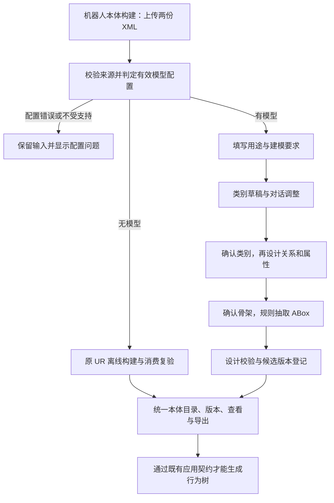

# IR-024 · 机器人本体模型辅助与离线双路径构建

- **状态 / Status**：delivered（2026-11-11 用户确认 T10 交付无问题，整轮验收通过）。
- **日期 / Date**：2026-11-09。
- **关联 / Refs**：[DR-070](../decisions/DR-070-robotics-dual-build.md)。
- **范围依据**：用户要求“当前先不考虑无 XML 的情况，要求用户必须上传 XML 文件，有 LLM 时走新方案，无时走原来的旧方案”。
- **流程依据**：[sdd-workflow](../../.agents/skills/sdd-workflow/SKILL.md)、[specs/meta.md](../meta.md)。
- **验收映射**：[acceptance.json](../acceptance.json)；已创建的测试进入 requirements，未创建的测试继续保留计划状态，不标记功能已验收。
- **冻结契约**：[机器人双路径构建 v1](../contracts/robotics-dual-build-v1.md)。
- **来源清单**：[IR-024 来源摘要](../sources/IR-024-yang-sources.json)。

## 目标 Goal

在现有机器人本体构建页面提供统一上传入口，自动选择新 TBox/ABox 模型方案或旧 XML 离线方案。
新方案完成“XML 与用途 → 类别设计 → 类别确认 → 关系与属性设计 → 骨架确认 → 规则抽取实例 → 本体版本保存、查看和导出”的闭环。
旧方案继续产出当前可消费的 UR 本体，数据本体构建与既有机器人任务应用不退化。
新设计本体的保存资格与行为树应用资格分开，不把 OWL 格式有效等同于应用兼容。

### 不在本轮范围

- 无 XML 构建、手动填写替代 XML、用户选择离线／模型模式。
- 任意机器人流程、嵌套控制结构或新设备驱动的自动支持。
- 在线修改受控词表、任意 OWL 公理生成、真实机器人执行或标定。
- 给两个外部工程各部署一个服务、复制其密钥配置或历史 sessions。
- 将所有领域改造成通用 Graph v2、重写现有 UR 编译器、自动把新设计本体补造成 UR 可执行本体。

### 代码现状与关键影响

| 当前代码 | 已有能力 | 本轮影响 |
|---|---|---|
| `ui/modules/robotics-build.js`、`bp_robotics.py` | 双 XML 上传、一次性后台构建、轮询 | 保留入口，增加要求输入、方式提示、设计工作区和会话恢复 |
| `domain_runs/build_service.py`、`robotics_build.py` | 输入冻结、幂等、固定模板计算 | 分流准入与旧构建算法解耦；旧算法不改 |
| `domain_runs/build_contracts.py` | 成功必须通过既有消费者复验 | 原契约保留；另加设计候选完成契约，不放宽全局校验 |
| `srv_engine.py`、`agent_runtime` | 平台模型配置与运行时 | 增加构建适配层和有效配置核对，不另建配置页 |
| `ontology_assets/store.py`、`storage.py` | RDF 候选存储、不可变版本、SQLite | 兼容迁移、新会话及设计运行；固定修订与工件引用 |
| `domains/robotics/authoring.py`、`views.py` | 固定业务实例维护、UR 专用视图 | 为设计候选提供类别、属性、实例展示，避免误调用 UR 读取器 |
| `consumer.py`、任务 API 与应用 UI | UR 消费检查、任务和历史 | 按资格过滤／阻止新设计候选；后端不能只依赖按钮状态 |
| 新 `tbox_chat_agent` | XML 证据、词表、阶段式模型设计、校验导出 | 提取为包内核心；重接平台模型、状态和存储 |
| 新 `abox_chat_agent` | TBox + XML 规则抽取、覆盖率与导出 | 提取确定性核心，不迁入其解释型模型调用 |

外部参考根目录为 `../yang_implementation/tbox_chat_agent/tbox_chat_agent/` 与 `../yang_implementation/abox_chat_agent/abox_chat_agent/`。
运行时不得引用上述目录、通过 sys.path 加载其模块或依赖它们的 .env、sessions 和 generated。
迁入前记录来源版本或文件摘要，区分被复用算法、修改内容与可再分发的词表／样例；不复制无关个人资料。
前期复核已观察到新 ABox 导出可通过 RDF/XML 语法检查，却被旧消费者以缺少 artifactContract 拒绝；实现时应固化为兼容边界用例。
前期定向测试通过不计为本迭代交付证据。

## 交付 Deliverables

- [x] D01：双路径选择契约、模型状态和输入校验，以及旧请求与历史兼容。
- [x] D02：包内 TBox 证据、词表、结构化提议、校验及确定性导出。
- [x] D03：持久化设计会话、确认状态机、并发与中断恢复。
- [x] D04：包内 ABox 规则抽取、缺口／覆盖报告及设计候选版本提交。
- [x] D05：统一构建页面、历史设计修订、候选详情及下载。
- [x] D06：候选契约分流和行为树应用准入，保留旧流程。
- [x] D07：离线确定性、模型替身、HTTP、真实浏览器与兼容迁移测试。
- [x] D08：使用文档、迁入说明、全量回归与真实模型试运行记录，等待人审交付。

### 用户流程与分流规则

| 情况 | 后端行为 | 用户可见结果 |
|---|---|---|
| 缺任一 XML、空文件或格式不合法 | 入队／模型调用前拒绝，不留下半成品来源组合 | 定位到具体输入 |
| 未配置模型且没有可支持运行时 | 固定 method=legacy_xml，调用旧路径 | “离线构建 · UR 抓移放模板” |
| 已有有效配置和受支持运行时 | 固定 method=llm_tbox_abox | “模型辅助构建”及设计阶段 |
| 模型路径没有用途描述 | 不调用模型，不切换离线 | 留在同页补充建模要求 |
| 配置残缺、无效或适配不支持 | 返回 configuration_error | 提示平台引擎设置问题 |
| 401／429／超时／连接失败／无效响应 | 本轮失败，不自动换方法或引擎 | 上一有效版本仍可查看，支持重试 |
| 失败重试时配置身份变化 | 维持原会话身份约束 | 恢复兼容配置或发起新构建 |
| XML 超出所选路径支持范围 | 返回 unsupported_source 及位置 | 不自动选择另一条算法 |

XML 校验分两层：共同层限制编码、体积、节点数、深度、DTD／实体和两种来源角色，算法层分别验证旧模板或新抽取器的结构限制。
不能在共同层先执行旧模板的全部限制，使新方案永远无法到达自己的校验器。
也不能因进入模型方案而不验证节点模型和流程引用冲突。
来源内容在一次设计会话内固定，更换任一 XML 需新建会话；旧文件和版本始终可追溯。

### 模块与接口

建议新增 `domains/robotics/modeling/` 包，分别承载 evidence、vocabulary、tbox、abox、export 和 validation。
算法以显式输入返回候选与报告，不导入 Flask、不访问外部工程、不读取平台密钥、不直接写资产库。
建议新增平台建模模型适配器和 `domain_runs/robotics_design_service.py`，负责配置解析、状态机、后台调度、幂等与提交。
模型边界返回受限 JSON，语义校验不交给模型自己判断。
复用现有能力查询、构建提交及运行详情接口，增加 method、session_ref、stage 等版本化字段，旧离线响应字段继续有效。
新增 `/api/robotics/design-sessions/<id>` 的只读查询，以及 messages、confirm-classes、edit-classes、confirm-schema、retry 操作；具体请求和状态见 T01 冻结契约。
写操作均带 request_id 和 expected_revision；确认操作还绑定被确认的快照摘要，版本冲突返回 409。
每个模型轮次和最终 ABox 抽取都是独立后台运行；设计会话通过 session_ref 串联，不将整个等待确认过程保持为 running。
拟新增 design_tbox 与 extract_abox 运行类型及各自结果契约，保留 build_ontology 的旧验证分支。
现有 runs 表对无资产来源运行有专门 CHECK 约束，必须通过显式 schema 迁移支持新运行，不能把新结果伪装成旧的 build_ontology。
功能关闭时写端点继续拒绝，读取历史不能触发迁移、建模或模型探测。

### 状态、快照与提交

设计阶段采用 classes、properties、abox；确认基线和当前修订分开保存。
运行状态继续区分 queued、running、completed、failed、interrupted；“一次模型调用完成”不等于“本体构建完成”。
类别确认冻结类别、能力问题、词表版本及摘要；关系阶段不能修改冻结内容。
返回类别阶段只改变当前阶段和确认状态，不删除历史关系版本；只有再次确认后才能重建下游。
最终骨架确认后执行规则 ABox，后续修改另建修订，并使上一 ABox 不再代表最新草稿。
JSON 修订保留原始输入引用、来源 SHA-256、词表及映射摘要、提示词版本、模型身份、确认记录和结构化报告。
RDF 候选和完整 design.json 的摘要写入同一运行 manifest，下载按固定版本取字节。
按用户 2026-11-10 补充要求，design.json 内嵌本体设计、已生成实例、来源证据、词表、消息、确认、覆盖及校验结果，不再拆成多个业务 JSON 保存；最终界面提供完整 JSON 与 OWL 下载。
失败、磁盘写入错误或并发冲突不得更新当前有效修订指针，也不得登记可见的假成功资产。
恢复时把正在执行但丢失工作进程的运行记为 interrupted；不自动再次调用模型，防止重复调用与重复版本。

### 语义与应用兼容

TBox 校验覆盖受控标识、类别无环、证据引用、能力问题引用、对象属性方向、完整并集、数据类型及冻结基线。
`class_ids` 是关联建议，不自动变为 domain，也不生成类级属性值或新限制公理。
来源引用有效仅证明可追溯，不能自动证明模型的领域解释正确；仍需用户确认。
ABox 校验覆盖调用身份、父子／步骤次序、端口方向、参数绑定、对象断言类型、字面量及遗漏报告。
同一技能的不同调用不能按名称合并，模型不得补造接口、单位或现场验证事实。
新旧方案共享已核实语义时可以复用纯函数，不要求首轮把两套抽取算法合并为一套。
设计候选使用独立 contract/version 元数据和通用视图，不强制转换为 Datamind 数据本体 JSON IR。
TBox 修订提供类别层次、对象属性、数据属性和待明确项；最终 ABox 版本再展示实例和断言。
目录、详情、下载、图谱及应用首页均须识别设计候选，不能仅修构建页后留下下游崩溃。
应用兼容按固定版本摘要计算，至少返回 supported／unsupported／invalid 及原因，不把全部候选加入可生成任务的选择列表。
任务创建 API 再次执行既有消费检查，禁止直接调用绕过 UI。
旧 UR 候选在结构与数据流通过后仍可使用原离线候选生成策略，不把正式适配证据重新设为基础生成前置条件。

## 任务 Tasks（每项一次提交）

每组 RED 提交须记录预期失败原因；测试经人审后再进入对应 GREEN 提交，不修改测试来掩盖实现错误。
如评审改变行为要求，应先修订 DR／IR 和测试，单独记录范围变化。

| 任务 | 内容 | 完成证据 |
|---|---|---|
| T01 | 确认 DR/IR、12 条验收草案；冻结接口、路由判定、模型适配和源文件迁入清单 | 已评审契约、来源摘要、确定不扩展无 XML 范围 |
| T02 RED | 编写配置分流、双 XML、零模型调用、错误不回退及旧路径回归测试 | 预期失败记录与人审 |
| T03 GREEN | 实现有效配置解析、分流与旧算法适配，保留旧 API 输入兼容 | RBD-01/02/03/04/12 对应测试通过 |
| T04 RED | 编写 TBox 阶段、词表、确认快照、ABox 确定性和语义导出测试 | 真实 XML + 合成模型响应，仅替换模型边界 |
| T05 GREEN | 迁入并适配 TBox/ABox 核心及模型调用，完成语义与来源验证 | RBD-05/06/07 对应测试通过 |
| T06 RED | 编写设计会话、数据库迁移、幂等、并发、中断、失败提交及候选应用分流测试 | 旧库与新库迁移夹具、故障注入记录 |
| T07 GREEN | 持久化状态机、新运行类型、候选契约、详情／导出和应用准入 | RBD-08/09/10 对应测试通过 |
| T08 RED | 编写 HTTP、前端控制器与真实浏览器双路径行为测试 | UI 需求断言与真实后端失败记录 |
| T09 GREEN | 同页输入、对话确认、进度、恢复、差异、下载和应用资格显示 | RBD-11 及 UI 相关条目通过 |
| T10 | 全量回归、已配置真实模型试运行、文档和待人审交付记录 | D01–D08 对应报告，待用户确认后 delivered |

T03 的内部调用接点可先独立验证；T07/T09 完成前不把未接好的模型路径对外显示为可用。
新增生产模块文件头关联 DR-070，关键约束可引用条款编号。
计划中的测试函数实际写入后才从 planned_requirements 移入 requirements；失败测试可以进入正式映射，但不能标记通过。

## 验收 Acceptance

以下业务口径与技术细则已随方案于 2026-11-10 获用户确认；勾选与 delivered 仍仅在人审交付后完成。

- [x] RBD-01：统一机器人入口要求两份有效 XML，缺失／错误输入不启动模型或构建。
- [x] RBD-02：无可用模型时采用原离线算法，输出语义及原应用能力不退化，网络模型调用数为零。
- [x] RBD-03：有可支持模型时采用新方案并复用平台配置，错误配置不冒充无模型，客户端不能强制改方法。
- [x] RBD-04：模型失败或会话中配置变化不静默切换旧算法／模型，上一有效结果可恢复并可重试。
- [x] RBD-05：类别与关系属性按阶段设计及确认，冻结基线、词表和来源有效，返回修改不会改写历史。
- [x] RBD-06：ABox 仅由确认 TBox 与 XML 规则生成，模型不能注入实例事实，抽取缺口如实报告。
- [x] RBD-07：导出保留类别、并集域／值域、类型化属性和实例语义，关联建议不变成错误公理。
- [x] RBD-08：修订、运行、来源、工件和确认记录可重启恢复，幂等／并发／磁盘失败不会产生重复或假成功。
- [x] RBD-09：新设计候选在平台可查看和导出，旧资产、旧工件、历史链接及只读访问保持兼容。
- [x] RBD-10：行为树应用明确拦截不兼容新候选，前后端一致；不绕过旧消费者或制造准备完成结论。
- [x] RBD-11：真实浏览器同页完成两种构建流程，能恢复阶段、查看差异和错误、下载固定版本，未增加无 XML 或模式选择入口。
- [x] RBD-12：模型配置、提示和附件边界受控，旧数据本体回退、机器人任务策略及功能开关不退化。

### 验证方式

1. 单元与服务测试使用临时资产库和固定 XML，在模型 transport/runtime 边界注入明确标识的合成响应，不替换抽取器、校验器或版本提交。
2. 配置矩阵覆盖完全未配置、配置残缺、有效配置、过期注册、多运行时优先序和会话中配置变化。
3. 旧路径使用真实 XML 对比图同构、关键流程／绑定语义及下载字节摘要，不以 RDF 序列化空白节点顺序要求逐字相同。
4. 迁移测试覆盖当前 schema=5 数据库、原运行约束、历史结果、只读访问、重启与损坏来源。
5. 浏览器测试用真实 Flask/Gunicorn 后端和资产存储，只将模型请求指向测试服务，不使用 route.fulfill 伪造核心构建成功。
6. 真实模型试运行采用已配置端点和可发送的项目样例，记录模型、提示词／词表版本、延迟、结果、校验和人工评阅，不记录密钥。
真实模型不可用时如实标注“未验证”，不能用合成响应声称自然语言建模质量已经通过。
7. 交付前运行 `.venv/bin/python scripts/check.py --suite all`，并将新测试接入对应检查段。
保持当前覆盖率下限 81.0%，不预填通过数量，不放宽现有检查门槛。
8. 用户检查交付物和验收后再勾选清单并标记 delivered。

## 本轮方案交付记录

2026-11-09 只新增 DR、IR、计划验收映射和索引。
未创建功能测试或生产实现，未调用模型或修改现有资产。
方案检查已通过：现有验收引用自检 1 项、9 个文档本地链接、12 条计划验收编号及 IR 对应关系、proposed 状态和未勾选交付清单，以及 git diff --check。
既有 75 条正式验收映射保持不变，12 条新映射仅存放于 planned_requirements，测试状态为 planned-not-created。
未运行功能全量回归，以上文档检查不能等同于上述功能验收。

## T01 / T02 记录（2026-11-10）

用户确认方案无问题并要求继续下一步，DR-070 已 accepted，本 IR 进入 in-progress。
T01 已冻结构建接口、模型路由、共同输入准入和来源摘要；详见冻结契约及 17 份来源文件清单。
T02 新增 62 项行为用例：51 项预期失败、11 项通过，0 收集错误、0 跳过。
原机器人 HTTP／构建流水线与验收追溯检查共 65 项通过，新增 Python 文件 ruff、mypy 及 diff 格式检查通过。
失败原因与覆盖边界见 [T02 RED 记录](../../docs/audits/IR-024-t02-red.md)。
RBD-01/02/03/04/12 已引用实际测试，RBD-04/12 为部分覆盖，其余验收保持计划状态。
未修改生产实现，未调用真实模型，未勾选交付／验收清单；测试人审后进入 T03 GREEN。

## T03 记录（2026-11-10）

用户确认 T02 测试覆盖没有问题，并要求按已确认方案实现 T03、让测试转绿。
实现平台模型路由快照、有效配置核对、单模型请求与失败边界、共同 XML 准入，以及原离线入口的方式标识。
公开 HTTP 准入执行新增预检查；原内部 BuildService 调用及后台领域校验保持兼容，继续处理旧来源运行。
请求重放在模型分流之前处理，空 description 保持旧请求指纹，非空 description 参与冲突检查。
T03 尚不创建模型设计会话；有效模型路径返回明确的 model_build_pending，能力接口 build_ready=false，不静默走旧算法。
T02 已审阅的测试文件未改动，62 项定向测试全部通过；4 项额外隔离诊断通过，没有真实模型网络调用。
全量回归发现一项旧 HTTP 测试仍要求损坏 XML 返回 202；经用户明确批准，改为共同准入 400、准确定位且不产生来源／运行，并同步旧验收引用。
旧 HTTP 测试修改后单独通过，完整回归从头重跑；1743 单元通过、5 项既有可选上游跳过，覆盖率 84.5%。
末段任务浏览器发现“先配任务模型、再构建旧资产”的夹具冲突；用户另行批准先离线构建再启用测试模型，59 条 assert 与 42 条 Playwright 断言未改。
用户批准仅重跑受影响检查：任务浏览器 12 项、全仓 ruff／mypy 均通过，生产与 T02 测试摘要未变；其余 9 个阶段复用完整回归通过记录，共 12 个阶段有通过证据。
原完整命令的退出码 1 保留，不冒记为 0；未跳过失败用例或降低门槛。
完整回归结果与实现边界见 [T03 GREEN 记录](../../docs/audits/IR-024-t03-green.md)。
本阶段不勾选整轮 Deliverables／Acceptance，不进入尚待后续 RED 与人审的 T04/T05。

## T04 RED 记录（2026-11-10）

用户要求继续下一步，按既定任务顺序编写 TBox/ABox 核心的失败测试，未提前实现 T05。
新增四组测试：来源／词表、TBox 阶段与受控语义、ABox 规则抽取、RDF 语义导出。
79 项中 78 项因包内 modeling 尚未实现而预期失败，1 项真实 XML／裁剪夹具独立核对通过；没有收集错误或跳过。
具体接口与覆盖边界见 [核心测试接口 v1](../contracts/robotics-modeling-core-v1.md)，结果见 [T04 RED 记录](../../docs/audits/IR-024-t04-red.md)。
RBD-05/06/07 已从计划映射移入实际测试映射，但状态为 RED；RBD-04/12 追加部分核心边界测试，其持久化与 HTTP 验收仍未完成。
仅裁剪测试用的已选 TBox schema，未迁入生产算法、词表或映射，测试不导入外部工程，不读取其历史会话与密钥。
T03 的生产及已审阅测试保持不变，原 62 项定向回归另行复核；没有重跑已知必红的完整 GREEN 检查。
依据 sdd-workflow 的“人 review 测试是否覆盖到位”，本阶段等待测试覆盖人审后进入 T05 GREEN。

## T05 GREEN 记录（2026-11-10）

用户在了解 T04 的模型替身、ABox 与导出测试边界后要求继续下一步，授权 T05 实现。
迁入包内 XML 证据、受控词表、TBox/ABox 语义校验和确定性抽取，不依赖外部工程目录。
模型设计复用 T03 BuildRoute 请求边界，增加纯阶段转换、类别／骨架确认、一次格式修正预算以及失败时保持输入状态。
ABox 不接收模型对象，导出不补造 UR 应用标记；来源工程的网络客户端、密钥读取、旧会话与 Web 服务没有迁入。
新增 jsonschema 运行时语义层依赖；开发环境已固定同一版本，不改变全仓检查门槛。
79 项 T04 测试全部通过，连同 62 项 T03 测试共 141 项定向通过；所有已审阅测试及夹具保持不变。
真实 XML／真实词表／平台适配器的整条核心链路额外通过，两次合成模型响应后抽取 25 次调用、129 个绑定并导出 2706 个 RDF 三元组；没有调用真实模型。
迁入来源与摘要见 [T05 清单](../sources/IR-024-t05-migration.json)，完整结果与边界见 [T05 GREEN 记录](../../docs/audits/IR-024-t05-green.md)。
HTTP 保持 model_build_pending，设计会话、数据库迁移和 UI 集成继续属于 T06–T09；不把核心通过等同于整轮交付。

T05 完整回归最终退出码 0：1822 单元通过、5 项可选上游跳过，覆盖率 84.7%（门槛 81%）；HTTP 551 通过、8 条件跳过，严格十轮 10/10。
UI 走查 64、UI 实操 50（3 项未配置真实模型跳过）、数据构建浏览器 10、机器人构建 18、审阅 16、任务 12 均通过。
来源／实现／测试摘要、各阶段退出码见 [T05 机器记录](../../docs/audits/IR-024-t05-green-results.json)。
没有修改已审阅测试，未调用真实模型，未改动用户常驻服务；T05 完成，整轮 IR 继续 in-progress。

## T06 RED 记录（2026-11-10）

用户要求继续下一步，按既定顺序编写设计服务、迁移和候选应用边界测试，没有进入 T07 实现。
新增六组测试及一个共享夹具模块，共 83 项：79 项预期失败、4 项既有契约基线通过，0 收集错误、0 跳过。
74 项失败来自尚不存在的 robotics_design_service；另外 5 项明确暴露 schema5 尚未升级及只读仍接受旧 schema 的迁移差异。
测试使用真实 XML、T05 核心、SQLite 和资产字节，只有平台 runtime.run_turn 响应为合成数据。
旧 schema5 由实现前代码实际生成后冻结，包含旧运行、来源、资产、manifest 及任务会话；测试不使用未来的新初始化器伪造旧库。
覆盖排队与人工确认分离、请求重放、修订和快照冲突、并发领取、网络等待锁边界、中断及迟到响应、来源损坏、文件／事务提交失败和显式重试。
最终 ABox 候选绑定确认、来源、词表、映射和工件摘要；部分抽取报告保留，不兼容设计版本继续由旧任务后端拒绝。
服务接口细化见 [设计服务测试接口 v1](../contracts/robotics-design-service-v1.md)，覆盖与失败证据见 [T06 RED 记录](../../docs/audits/IR-024-t06-red.md)。
RBD-08/09/10 移入实际测试映射但状态为 RED；关联已通过条目追加 T06 测试并标明新旧结果混合，不把旧通过记录当作新功能验收。
T03/T05 的 141 项定向回归全部通过，生产文件及已审阅测试摘要保持不变；新测试 ruff、mypy 和验收引用检查通过。
未修改生产代码、未调用真实模型、未重启常驻服务，也未运行已知必红的完整 GREEN 检查。
HTTP 与 UI 仍未形成模型构建闭环；T08/T09 的界面与浏览器工作、T10 的真实模型质量验证保持后续范围。
依据 sdd-workflow 第⑤环节“人 review 测试是否覆盖到位”，当前提交具体测试与 RED 证据供人审；确认后进入 T07 GREEN。
整轮 Deliverables／Acceptance 不勾选，IR 不标记 delivered。

## T06 评审修订：完整 JSON（2026-11-10）

用户在查看来源工程的 TBox JSON 后，明确要求“一个总的 JSON 文件，而不是拆分成几个文件分开保存”，不要求逐字段兼容。
修订 DR-070 及相关契约：阶段 JSON 完整保存该阶段信息；最终 design.json 增加 ABox、覆盖和校验结果，与 candidate.owl 同次固定保存。
manifest 仅为平台内部工件登记，不作为需要配套下载的业务内容；UI 主要下载项为完整 JSON 与 OWL。
已修改尚待评审的 T06 资产与故障测试；用单 JSON 验证可重建 OWL、报告内嵌、历史下载不变，并将两个分片文件的故障点合并为完整 JSON 写入故障点。
用例总数由 83 调整为 82，不减少实例、覆盖报告和事务完整性的业务断言；T03/T05 测试及生产实现不变。
修订 RED 结果与摘要见 [统一 JSON 修订记录](../../docs/audits/IR-024-t06-unified-json.md)；旧 T06 RED 记录保留为历史，不覆写当时的 83 项结果。

## T07 GREEN 记录（2026-11-10）

用户确认总 JSON 文件组织方式后要求继续下一步，授权按修订后的 82 项 T06 测试实现。
完成 schema5→6 迁移、独立设计运行输入、持久化会话／修订／回执、并发领取和显式中断恢复。
模型网络等待不持有写事务或 RDF 锁，最终语义校验先于数据库提交；迟到响应不能覆盖重试。
最终完整 design.json 内嵌设计、实例、来源、词表、消息、确认及覆盖／校验结果，与 OWL 原子保存；后续版本不覆盖历史下载。
新增候选详情、通用图谱、完整 JSON 导出及按固定版本内容计算的应用资格；旧任务消费者继续拦截不兼容候选。
修复证据经过 JSON 保存后属性遍历顺序导致的抽取数组顺序差异，不改流程顺序或原离线构建器。
所有已审阅测试及夹具保持不变，223 项定向通过，全量 12 阶段通过，完整命令退出码 0。
结果与实现摘要见 [T07 GREEN 记录](../../docs/audits/IR-024-t07-green.md) 和 [机器记录](../../docs/audits/IR-024-t07-green-results.json)。
公开模型上传仍返回 model_build_pending，build_ready=false；HTTP 设计操作、宿主调度与 UI 在 T08/T09 接入，真实模型试运行归属 T10。
未调用真实模型、未重启用户服务、未迁移用户生产库；IR 保持 in-progress，整轮交付／验收复选框仍待最终人审。

## T08 RED 记录（2026-11-10）

用户在 T07 完成后要求继续下一步，按既定顺序编写 HTTP、控制器与真实浏览器／宿主测试，未进入 T09 实现。
新增 56 项 HTTP、28 项前端控制器／回归注册、14 项浏览器／宿主检查，共 98 项，14 通过、84 预期失败，无跳过或夹具错误。
浏览器使用独占临时 Gunicorn 与本地合成模型 HTTP，不拦截应用接口；模型／浏览器环境、真实旧离线构建与平台运行时到核心链路的对照通过。
模型入口、设计端点、阶段工作区、宿主自动调度／中断恢复与不兼容候选 UI 分流的 RED 已记录；首次失败之后的完整流程断言待 T09 验证。
完整 JSON 与 OWL 下载、历史修订和差异、刷新不重提、失败显式重试均纳入测试。
接口细化见 [HTTP 与页面测试接口](../contracts/robotics-design-http-ui-v1.md)，结果见 [T08 RED 记录](../../docs/audits/IR-024-t08-red.md) 与 [机器记录](../../docs/audits/IR-024-t08-red-results.json)。
生产文件与所有已审阅测试／夹具摘要未改变；既有 223 项定向检查继续通过，ruff 与 mypy 通过。
RBD-11 从计划映射转入实际测试引用，其余关联条目标记 T08 RED 或新旧混合状态，不把既有核心通过等同于公开功能完成。
依据 sdd-workflow 第⑤环节“人 review 测试是否覆盖到位”，本次交付测试供评审；确认后进入 T09 GREEN。
未调用真实模型、未重启用户服务、未迁移用户数据库；IR 保持 in-progress，交付及验收复选框未勾选。

## T09 GREEN 记录（2026-11-10）

用户了解 T08 测试后要求继续下一步，授权 T09 实现；98 项已审阅测试及所有既有测试保持不变。
完成公开设计接口、固定修订与下载、新设计后台领取／启动恢复、同页阶段工作区、候选详情及应用资格分流。
设计页面以表格呈现类别／关系／属性，历史比较保留当前修订，模型回复经文本转义。
307 项定向检查、14 项真实浏览器／宿主检查以及完整 13 阶段全部通过。
结果见 [T09 实现与验证](../../docs/audits/IR-024-t09-green.md) 和 [机器记录](../../docs/audits/IR-024-t09-green-results.json)。
平台模型路径已公开接通；测试使用本地合成模型 HTTP，尚未执行 T10 的真实模型语义质量验证。
未重启用户常驻服务、未迁移用户实际数据库；IR 与最终验收复选框保持待人审。

## UI 试用修复：确认类别后的阶段引导（2026-11-10）

确认类别已正确进入 properties/awaiting_input；前端旧回复残留导致用户误认为仍需确认类别。
新增阶段引导、显式开始属性设计按钮及历史提示分组，不改变后台阶段契约。
68 项控制器检查、14 项浏览器检查及单次属性阶段模型请求诊断通过；已审阅测试不变。
见 [修复记录](../../docs/audits/IR-024-design-stage-guidance.md)。

## UI 试用修复：本体库加载（2026-11-11）

修复目录遍历所有历史版本导致响应慢，以及未加载完就显示空目录的问题。
保留固定版本资格检查；96 项定向检查、加载诊断及在线真实浏览器验证通过，已构建候选正常显示。
见 [修复记录](../../docs/audits/IR-024-catalog-loading.md)。

## UI 试用修复：设计候选详情（2026-11-11）

补齐 T09 已规划的设计骨架／实例展示、检查状态和设计会话导航；不改变新旧消费契约边界。
71 项控制器、14 项设计浏览器和在线真实浏览器验证通过，已审阅测试保持不变。
未兼容 UR 的新候选仍有意不开放行为树生成；该适配不在 T10 收尾范围内。
见 [修复记录](../../docs/audits/IR-024-design-detail.md)。

## UI 试用修复：统一实例图谱口径（2026-11-11）

按用户指令统一新旧关系图为实例视图，复用分组／类型名称，新增类型筛选和当前／总数统计，明确无业务实例的情况。
保留完整本体和 API 泛化节点兼容，不改变设计、实例、抽取范围和行为树资格。
71 项单元、14 项设计浏览器、18 项旧构建浏览器及在线实例筛选／文件不变性验证通过；已审阅测试不变。
见 [统一实例图谱记录](../../docs/audits/IR-024-unified-instance-view.md)。

## T10：回归、真实模型试运行与交付材料（2026-11-11）

用户要求先完成原 SDD 最后一个 Task，流程重设计留待新 DR。
完整 13 阶段回归全部通过，退出码 0，包含全部 UI 试用修复。
单元 1988 项通过、5 项既有可选跳过；覆盖率见 T10 机器记录。
采用用户实际完成的 deepseek-flash 设计会话进行只读核验：来源和工件完整、规则重抽取一致、重新导出 RDF 同构。
本次不新增模型请求，不改写用户存储，不重启常驻服务，不扩展 UR 行为树适配。
补齐双路径指南、迁入说明链接、API/UI 文档和 D01–D08 交付对照。
见 [T10 交付记录](../../docs/audits/IR-024-t10-delivery.md) 和 [机器记录](../../docs/audits/IR-024-t10-results.json)。
T10 工程工作完成；Deliverables／Acceptance 勾选及 delivered 仍待用户最终人审。

## 最终人审交付（2026-11-11）

用户确认“确认没有问题”，授权将本轮代码提交到 dyh_dev。
D01–D08 和 RBD-01–12 已经人审确认，清单勾选，IR 状态为 delivered。
以上各阶段的待人审描述保留为历史；最终以本节和当前状态为准。
整体流程重设计另行讨论新 DR，不包含在本轮交付中。
